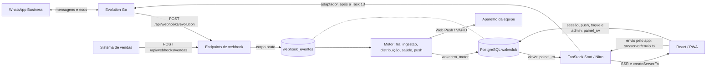
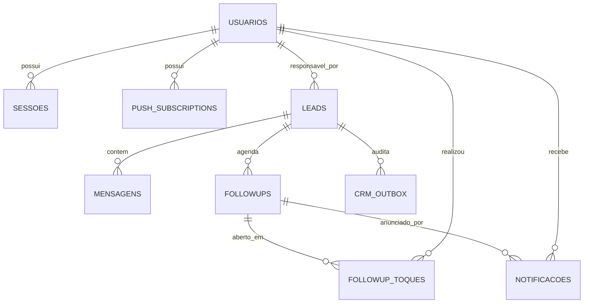

# Arquitetura atual do Wake Club Dashboard

> Snapshot da Fase 0 em 11/08/2026, revisado em 04/11/2026 para a fase 1 do WakeCRM
> (motor próprio). As seções de contexto, stack, variáveis, rotas, módulos, dados e
> roles descrevem o código atual; as marcadas como legado descrevem o que existia antes.
>
> **Estado em 04/11/2026:** a fase 1 está **implementada localmente e não publicada**.
> Os workflows n8n estão parados e **nunca rodam em paralelo com o motor**; as
> exportações estão em `docs/n8n-legado/` (só fonte de lógica). O adaptador do Evolution
> Go depende da captura de eventos reais (Task 13 do plano): sem ele o webhook só grava
> bruto e o envio pelo app fica desligado. Desenho:
> `docs/superpowers/specs/2026-11-03-wakecrm-motor-proprio-design.md`; plano:
> `docs/superpowers/plans/2026-11-04-wakecrm-fase-1.md`.

## Resumo executivo

O dashboard é uma aplicação TanStack Start que apresenta o CRM em PostgreSQL. Desde a
fase 1 o mesmo processo também hospeda o motor que antes era o n8n (fila de webhooks,
ingestão, distribuição, saúde e notificações). O navegador nunca acessa o banco diretamente: as rotas React chamam
`createServerFn`, os módulos em `src/server/` consultam views com `painel_ro` e usam
`painel_rw` apenas nas exceções de escrita explicitamente concedidas.

O produto atual já possui:

- login próprio e autorização por `admin`/`atendente`;
- conversas, Kanban, auditoria do WF-02 e relatórios para admin;
- fila de followups e leads isolados por atendente;
- PWA sem cache offline e entrega Web Push;
- administração de atendentes e aparelhos;
- saúde da instância Evolution.

O modelo ainda é centrado em `leads`. Não existem hoje as tabelas `opportunities`,
`contacts`, `automation_events` ou `followup_feedback`, nem uma operação unificada para
carregar o workspace de uma oportunidade.

## Contexto do sistema



Os webhooks e o motor vivem no mesmo processo Nitro do painel. O envio pelo app depende
do adaptador do Evolution Go, que ainda não existe (Task 13).

Responsabilidade operacional:

- **motor** (`MOTOR_ATIVO=1`): ingere mensagens, distribui leads, mantém a saúde do
  número e a fila de notificações. Qualificação por IA, transcrição e followups
  sugeridos voltam em fases posteriores.
- **dashboard:** lê o CRM, autentica a equipe, registra inscrições e aberturas, envia
  mensagens pelo app (quando houver adaptador) e entrega Web Push.
- **atendente:** decide se edita e se envia o texto. A mensagem enviada pelo app grava
  autoria; a enviada pelo celular do número chega como eco e é marcada `celular`.
- **n8n:** desligado de vez; histórico em `docs/n8n-legado/`.

## Stack e execução

| Camada            | Implementação atual                                                              |
| ----------------- | -------------------------------------------------------------------------------- |
| Interface         | React 19, TanStack Router/Start, TanStack Query, Tailwind v4 e shadcn/ui         |
| Servidor          | TanStack Start com Nitro; entrada em `src/server.ts`                             |
| Motor             | trabalhador da fila e tarefas agendadas no mesmo processo; boot por plugin Nitro |
| Banco             | PostgreSQL 14, schema `wakeclub`, driver `pg`                                    |
| Validação         | Zod nas fronteiras de server functions e API                                     |
| Autenticação      | bcrypt, cookie HttpOnly e token persistido como SHA-256                          |
| PWA/Push          | manifest, service worker nativo e `web-push` com VAPID                           |
| Build             | Bun + Vite; saída em `.output/`                                                  |
| Container         | Bun Alpine, usuário não-root `bun`, porta 3000                                   |
| Publicação        | GitHub Actions publica no GHCR em push para `main`, tags `v*` ou despacho manual |
| Produção descrita | Docker Swarm/Portainer, Traefik e rede externa `NovaNet`                         |

Dependências externas necessárias:

- PostgreSQL do CRM `wakeclub`;
- Evolution Go para WhatsApp e mídia (adaptador pendente, Task 13);
- sistema de vendas, que chama `POST /api/webhooks/vendas`;
- provedores Web Push dos navegadores;
- GHCR, Docker Swarm/Portainer e Traefik para publicação.

Variáveis consumidas pelo dashboard:

| Variável                   | Consumidor                                    | Finalidade                                                       |
| -------------------------- | --------------------------------------------- | ---------------------------------------------------------------- |
| `DATABASE_URL`             | `src/server/db.ts`                            | conexão `painel_ro`, forçada read-only                           |
| `DATABASE_URL_RW`          | `src/server/db.ts`                            | conexão limitada `painel_rw`                                     |
| `VITE_VAPID_PUBLIC_KEY`    | cliente e servidor                            | chave pública da inscrição push                                  |
| `VAPID_PRIVATE_KEY`        | servidor                                      | assinatura Web Push                                              |
| `PUSH_DISPATCH_SECRET`     | rota de push                                  | autenticação da rota `POST /api/push/enviar` (legado do WF-09)   |
| `DATABASE_URL_MOTOR`       | `src/server/db.ts`                            | conexão da role `wakecrm_motor` (fila, motor, respostas rápidas) |
| `WAKECRM_MOTOR_PASSWORD`   | `scripts/migrar.mjs`                          | cria/redefine a senha da role do motor; igual à da URL           |
| `MOTOR_ATIVO`              | `nitro-plugin.ts`                             | `1` liga fila e tarefas neste processo; vazio desliga            |
| `WEBHOOK_EVOLUTION_SECRET` | `webhooks/receber.ts`                         | segredo do webhook da Evolution; ausente = 404                   |
| `WEBHOOK_VENDAS_SECRET`    | `webhooks/receber.ts`                         | segredo do webhook de vendas; ausente = 404                      |
| `EVOLUTION_INSTANCIA`      | `motor/iniciar.ts`                            | nome da instância (heartbeat e saúde); padrão `wakeclub`         |
| `ADMIN_DATABASE_URL`       | `scripts/painel-db.mjs`, `scripts/migrar.mjs` | roles, views e migrações; não usada pela aplicação               |
| `PAINEL_RO_PASSWORD`       | `scripts/painel-db.mjs`                       | configuração da role de leitura                                  |
| `PAINEL_RW_PASSWORD`       | `scripts/painel-db.mjs`                       | configuração da role limitada de escrita                         |

## Organização do código

```text
src/
├── routes/        páginas, loaders, guards e rotas HTTP (push e webhooks)
├── server/        createServerFn e SQL server-only
│   ├── motor/     fila, agenda, ingestão, distribuição, saúde, notificações, boot
│   ├── evolution/ tipos e ponto único do adaptador do Evolution Go
│   └── webhooks/  recepção autenticada que grava o corpo bruto na fila
├── features/      admin, conversa (envio) e respostas-rapidas
├── components/    shell, navegação, PWA e componentes shadcn
├── lib/           formatação, push cliente e tratamento de erros
├── start.ts       middleware global de erro
└── server.ts      entrada Nitro e normalização de falhas SSR
```

`db/migrations/` guarda o schema (`0001_base`, `0002_motor`, `0003_virada`); o runner é
`scripts/migrar.mjs`.

`src/server/db.ts` é o único módulo que importa `pg` (pools `getPool`, `getPoolRw`,
`getPoolMotor` e `getPoolWebhook`, este só do endpoint de webhook). `vite.config.ts` inclui os
módulos com `createServerFn` em `importProtection.client.excludeFiles`; `db.ts` não é
excluído e, portanto, não pode chegar ao bundle cliente.

O shell em `src/routes/__root.tsx` carrega a sessão e a saúde do número. A navegação em
`AppSidebar.tsx` mostra menus diferentes para admin e atendente.

## Rotas e superfícies HTTP

| Rota                           | Acesso atual                                     | Dados/ação principal                                          | Atualização             |
| ------------------------------ | ------------------------------------------------ | ------------------------------------------------------------- | ----------------------- |
| `/login`                       | pública                                          | `entrar`, com redirecionamento por papel                      | sob demanda             |
| `/`                            | admin                                            | lista de conversas e thread por `getConversas`/`getMensagens` | 30 s                    |
| `/kanban`                      | admin                                            | cards de `getLeadsPainel` e histórico por `getMensagens`      | 30 s                    |
| `/wf02`                        | admin                                            | atividade, motor e followups por `getPainelWf02`              | 30 s                    |
| `/reports`                     | admin                                            | quatro views agregadas por `getRelatorios`                    | 60 s                    |
| `/admin`                       | admin                                            | resumo, atendentes, aparelhos e ações administrativas         | loader/refetch por ação |
| `/followups`                   | atendente                                        | `listarMinhaFila` e `registrarToque`                          | 60 s                    |
| `/meus-leads`                  | atendente                                        | leads atribuídos e mensagens com validação de posse           | sob demanda             |
| `/instalar`                    | usuário autenticado                              | instalação PWA, permissão e inscrição push                    | sob demanda             |
| `/templates`                   | admin                                            | cadastro real de respostas rápidas (`respostas-rapidas.ts`)   | sob demanda             |
| `POST /api/push/enviar`        | segredo                                          | valida payload e chama `entregarPush`                         | sob demanda             |
| `POST /api/webhooks/evolution` | segredo (header `x-webhook-secret` ou `?token=`) | grava o corpo bruto em `webhook_eventos` com chave de ordem   | sob demanda             |
| `POST /api/webhooks/vendas`    | idem                                             | grava o corpo bruto em `webhook_eventos`                      | sob demanda             |

Os webhooks respondem 404 com segredo inválido ou ausente, 400 para JSON inválido e 413
acima de 25 MB (nesse caso fica uma linha `falhou` com o tamanho, sem o corpo).

As operações `createServerFn` são RPCs gerados pelo TanStack Start, não endpoints REST
de domínio mantidos manualmente. Não existe atualmente
`GET /api/opportunities/:leadId/workspace` nem `getOpportunityWorkspace`.

## Módulos server-only

| Módulo                 | Funções expostas                                                                | Fonte de dados / escrita                                                                    |
| ---------------------- | ------------------------------------------------------------------------------- | ------------------------------------------------------------------------------------------- |
| `db.ts`                | `getPool`, `getPoolRw`, `getPoolMotor`, `getPoolWebhook`, `comTransacao`        | cria os quatro pools PostgreSQL                                                             |
| `log.ts`               | `logErro`, `logInfo`                                                            | único lugar com `console`; sem texto de conversa nem segredo                                |
| `admin-motor.ts`       | monitor da fila, reprocesso, peso/comissão, correção de dono                    | `webhook_eventos`, `usuarios`, `leads`; exige admin                                         |
| `respostas-rapidas.ts` | listar ativas, listar todas, salvar, remover                                    | `respostas_rapidas` via `wakecrm_motor`                                                     |
| `envio.ts`             | envio de texto e mídia pelo app                                                 | confere posse, chama o adaptador, grava `mensagens` com autoria; indisponível sem adaptador |
| `motor/*`              | `iniciarMotor`, `rodarFila`, `agendar`, ingestão, distribuição, saúde, push     | role `wakecrm_motor`; ver "Motor"                                                           |
| `webhooks/receber.ts`  | `receberWebhook`, `enfileirar`                                                  | INSERT em `webhook_eventos`                                                                 |
| `evolution/`           | `obterAdaptador` (hoje `null`), `chaveDeOrdemEvolution`, tipos                  | sem rede até a Task 13                                                                      |
| `auth.ts`              | `entrar`, `getSessao`, `sair`, `exigirSessao`, `exigirAdmin`, `exigirAtendente` | `usuarios`, `sessoes`, `v_sessao_valida`                                                    |
| `leads.ts`             | `getLeadsPainel`                                                                | `v_leads_painel`                                                                            |
| `conversas.ts`         | `getConversas`, `getMensagens`                                                  | `v_conversas_painel`, `v_mensagens_painel`, `v_mensagens_autoria`                           |
| `wf02.ts`              | `getWf02Atividade`, `getWf02Motor`, `getFollowups`, `getPainelWf02`             | views do WF-02, followups e leads                                                           |
| `relatorios.ts`        | `getRelatorios`                                                                 | quatro views de relatório                                                                   |
| `saude.ts`             | `getSaudeNumero`                                                                | `v_saude_numero`                                                                            |
| `followups.ts`         | `listarMinhaFila`, `registrarToque`                                             | `v_followups_fila`; INSERT em `followup_toques` após validar posse                          |
| `meus-leads.ts`        | `listarMeusLeads`, `listarMensagensDoMeuLead`                                   | views de leads/mensagens filtradas por usuário                                              |
| `push.ts`              | chave pública, inscrição e push de teste                                        | `push_subscriptions`                                                                        |
| `admin.ts`             | painel, alteração/cadastro de atendente, remoção de aparelho e push de teste    | views admin, `usuarios`, `push_subscriptions`                                               |
| `push-dispatch.ts`     | `entregarPush`                                                                  | aparelhos ativos; atualiza falhas/uso e remove inscrições 404/410                           |

## Motor

Código em `src/server/motor/`, banco pela role `wakecrm_motor` (`getPoolMotor()`).

**Boot.** `nitro-plugin.ts` roda no start do Nitro, antes de qualquer requisição, e só
chama `iniciarMotor()` com `MOTOR_ATIVO=1`. O `src/server.ts` carrega sob demanda,
então ligar o motor ali deixaria um restart sem tráfego com a fila parada.
`iniciarMotor()` é idempotente (guarda em `globalThis`).

**Fila.** Os endpoints só inserem em `webhook_eventos`. O trabalhador roda a cada 2 s,
reivindica até 4 cabeças com `FOR UPDATE SKIP LOCKED` (sem trava global; é seguro entre
réplicas) e processa cada evento na própria transação.

- Eventos da mesma `chave_ordem` (a conversa) saem em sequência estrita: só a cabeça da
  chave é elegível, e uma cabeça em `processando` ou com retentativa futura segura a
  chave. Chaves diferentes rodam em paralelo.
- Falha: até 5 tentativas, com esperas de 30, 120, 600 e 1800 s; na quinta o status é
  `falhou`, visível no monitor do admin e reprocessável (`reprocessar`).
- Órfãos: `processando` há mais de 15 min volta a `pendente`.
- Origem sem processador não é reivindicada: sem adaptador, eventos da Evolution ficam
  `pendente` (gravados, não processados). Vendas só são gravadas nesta fase.
- Corpo acima de 25 MB: 413 e linha `falhou` com tamanho e erro.

**Tarefas agendadas** (`agenda.ts`: intervalo fixo, uma execução por vez, trava
advisory no banco), registradas em `iniciar.ts`:

| Tarefa         | Intervalo | O que faz                                                |
| -------------- | --------- | -------------------------------------------------------- |
| fila           | 2 s       | `rodarFila` em laço até esvaziar (sem trava global)      |
| `orfaos`       | 5 min     | `devolverOrfaos`                                         |
| `distribuicao` | 5 min     | `soltarDeInativos` + `redistribuirSoltos` numa transação |
| `push`         | 1 min     | `enviarPushPendentes` (fila `notificacoes`, sem n8n)     |
| `heartbeat`    | 5 min     | `gravarHeartbeat`; só existe com adaptador               |

**Distribuição.** Por peso entre vendedores ativos, com atribuição pegajosa (o lead que
já teve dono fica com ele enquanto estiver ativo) e menção na conversa. Toda mudança de
dono gera `assignment_changed` com o motivo (`rodizio`, `mencao`, `desativacao`,
`admin`) e preenche `leads.atribuido_por`.

**Ingestão.** `registrarMensagem` faz upsert do lead, insere a mensagem de forma
idempotente, trata opt-out (evento `opt_out`), toque e eco e distribui lead sem dono.
Hoje só processa o tipo `mensagem` do evento normalizado.

**Saúde e notificações.** `saude.ts` mantém `instancia_estado`/`instancia_eventos` a
partir de eventos de conexão, ack e heartbeat; `notificacoes.ts` cria a fila de push e
`push` a entrega via `entregarPush`.

## Modelo de dados

### Entidades do CRM

| Tabela              | Papel                                                         | Relações e observações                                                                                                                    |
| ------------------- | ------------------------------------------------------------- | ----------------------------------------------------------------------------------------------------------------------------------------- |
| `leads`             | contato + oportunidade + estado comercial no modelo legado    | telefone único; etapa em `etiqueta`; temperatura; responsável; relógio `qualificar_apos`; flags `opt_out` e `sem_atendimento`             |
| `mensagens`         | histórico bruto da conversa                                   | N:1 com lead; direção `lead/equipe/ia`; idempotência por `evolution_msg_id`; ack de entrega e estado de transcrição                       |
| `followups`         | agenda e sugestão produzida pela IA                           | N:1 com lead; no máximo um pendente por lead; possui motivo, ciclo de vida, `texto_sugerido` e `sugerido_em`                              |
| `crm_outbox`        | outbox para integração futura e trilha atual de qualificações | N:1 com lead; `tipo='qualificacao'` guarda payloads usados por `v_wf02_atividade`                                                         |
| `instancia_eventos` | histórico append-only da saúde Evolution                      | chave lógica por instância e horário                                                                                                      |
| `instancia_estado`  | snapshot da saúde da instância                                | uma linha por instância; conexão, heartbeat e QR                                                                                          |
| `eventos_automacao` | auditoria das decisões do motor                               | criada na 0001; uma linha por decisão, no mesmo comando SQL que muda o dado; nunca guarda raciocínio, prompt ou conversa                  |
| `webhook_eventos`   | fila de entrada dos webhooks (0002)                           | `origem` (`evolution`/`vendas`), `corpo jsonb`, `status`, `tentativas`, `proxima_tentativa_em`, `chave_ordem`; índice parcial nas abertas |

### Entidades da equipe

| Tabela               | Papel                                  | Relações e observações                                                                 |
| -------------------- | -------------------------------------- | -------------------------------------------------------------------------------------- |
| `usuarios`           | login, papel e estado da pessoa        | recebe leads, sessões, aparelhos e toques; `senha_hash` server-only                    |
| `sessoes`            | sessões de 30 dias                     | N:1 com usuário; armazena hash do token e revogação                                    |
| `push_subscriptions` | aparelhos inscritos                    | N:1 com usuário; endpoint e chaves são sensíveis                                       |
| `notificacoes`       | fila persistente controlada pelo WF-09 | destinatário opcional; pode referenciar followup; status inclui `cancelada`            |
| `followup_toques`    | log de abertura do WhatsApp            | N:1 com followup e usuário; append-only                                                |
| `whatsapp_labels`    | catálogo retornado por `findLabels`    | não prova labels por conversa; vínculo de usuário é legado/decorativo no desenho atual |
| `respostas_rapidas`  | textos prontos por `/atalho` (0002)    | cadastro do admin em `/templates`; leitura por qualquer sessão (só ativas)             |
| `migracoes`          | registro das migrações aplicadas       | por `scripts/migrar.mjs`; cada arquivo roda numa transação e é registrado uma vez      |

### Relações principais



Colunas novas da 0002: `usuarios.peso` e `usuarios.comissao_pct` (distribuição e
comissão), `leads.atribuido_por` (motivo da última atribuição), `mensagens.usuario_id`
e `mensagens.enviada_por` (`app`, `celular` ou `null` para legado). Mensagens enviadas
pelo app (`src/server/envio.ts`) levam autoria; as anteriores à virada não têm, e o
autor não é inventado. Métricas antigas por atendente continuam calculadas pelo lead
atribuído.

A 0003 é o corte da virada: só se aplica no momento do corte (`--ate 0002` antes disso).
Ver `docs/runbook-virada.md`.

## Views expostas ao dashboard

| View                         | Finalidade                                                  | Consumidor atual         |
| ---------------------------- | ----------------------------------------------------------- | ------------------------ |
| `v_leads_painel`             | card do funil, responsável, espera e followup pendente      | Kanban e Meus Leads      |
| `v_saude_numero`             | snapshot e alerta da Evolution                              | shell global             |
| `v_conversas_painel`         | inbox com última mensagem e contagens                       | `/`                      |
| `v_mensagens_painel`         | thread com texto e ack                                      | `/`, Kanban e Meus Leads |
| `v_mensagens_autoria`        | autoria da mensagem da equipe (0002, versionada)            | `/`, Kanban e Meus Leads |
| `v_wf02_atividade`           | antes/depois das qualificações reconstruído do `crm_outbox` | `/wf02`                  |
| `v_wf02_motor`               | fila, retries suspeitos e órfãos do qualificador            | `/wf02`                  |
| `v_followups_painel`         | agenda e status dos followups                               | `/wf02`                  |
| `v_relatorio_resumo`         | KPIs gerais                                                 | `/reports`               |
| `v_relatorio_funil`          | distribuição por etapa                                      | `/reports`               |
| `v_relatorio_volume_dia`     | mensagens por dia                                           | `/reports`               |
| `v_relatorio_wf02_dia`       | qualificações por dia                                       | `/reports`               |
| `v_sessao_valida`            | sessão ativa sem expor senha                                | autenticação             |
| `v_followups_fila`           | sugestão pendente, toques e eco separados                   | `/followups`, `/wf02`    |
| `v_admin_labels_disponiveis` | catálogo ainda não associado a usuário                      | `/admin`                 |
| `v_admin_atendentes`         | métricas por lead atribuído                                 | `/admin`                 |
| `v_admin_resumo`             | fila, toque, eco, abortos e distribuição                    | `/admin`                 |

## Roles e privilégios

### `painel_ro`

- recebe SELECT somente nas views acima;
- a conexão acrescenta `default_transaction_read_only=on`;
- não acessa diretamente as tabelas do CRM.

### `wakecrm_motor`

Criada por `scripts/migrar.mjs` quando `WAKECRM_MOTOR_PASSWORD` está definida; a 0002
falha sem ela. Grants:

- SELECT/INSERT/UPDATE em `leads`, `mensagens`, `followups`, `crm_outbox`,
  `eventos_automacao`, `instancia_eventos`, `instancia_estado`, `notificacoes` e
  `webhook_eventos`;
- SELECT/INSERT/UPDATE/DELETE em `respostas_rapidas`;
- SELECT em `push_subscriptions` e `followup_toques`;
- SELECT em `v_followups_fila` quando a view existe (só em produção; o push do motor lê);
- SELECT por coluna em `usuarios` (sem `senha_hash`) e UPDATE de `peso`, `comissao_pct`
  e `ativo`;
- USAGE nas sequências do schema. Sem DELETE nas demais tabelas.

### `painel_rw`

Superfície atual comprovada pelo script:

- SELECT em `usuarios`, usado apenas no servidor para autenticação/admin, mais INSERT e
  UPDATE de `peso` e `comissao_pct` (0002);
- INSERT limitado ao cadastro de `usuarios` e UPDATE limitado a
  `ultimo_acesso_em`/`ativo`;
- SELECT/INSERT/UPDATE/DELETE em `sessoes` e `push_subscriptions`;
- INSERT em `followup_toques`;
- SELECT de `leads.id/sem_atendimento/sem_atendimento_motivo` e UPDATE apenas das duas
  colunas de `sem_atendimento`;
- nenhuma leitura geral de `leads` e nenhum UPDATE de `etiqueta` ou `atendente_id`;
- nenhum acesso a `mensagens`, `followups`, `crm_outbox`, `notificacoes` ou tabelas de
  saúde.

`scripts/painel-db.mjs` é a implementação executada por `db:apply` e `db:check`;
`../db/painel-role.sql` documenta a superfície, mas não é aplicado diretamente pelo
script.

## Workflows n8n (legado, parados)

Os arquivos exportados estão em `docs/n8n-legado/`; servem só como fonte para portar
lógica. A tabela descreve o comportamento original.

| Workflow           | Gatilho                                   | Função e efeitos principais                                                                                                                            |
| ------------------ | ----------------------------------------- | ------------------------------------------------------------------------------------------------------------------------------------------------------ |
| WF-01 Ingestor     | webhook Evolution                         | normaliza evento, faz upsert do lead, insere mensagem idempotente, registra movimento, cancela followup quando a conversa anda e agenda requalificação |
| WF-02 Qualificador | a cada minuto                             | reivindica `qualificar_apos`, lê conversa, usa OpenAI `gpt-5.4-mini`, valida decisão, atualiza o lead, grava qualificação no outbox e agenda followup  |
| WF-03 Redator      | a cada 15 minutos                         | reivindica followups vencidos sem texto, executa Porteiro (`gpt-5.4-mini`) e Redator (`gpt-5.4`), grava sugestão/notificação ou reagenda/aborta        |
| WF-07 Saúde        | eventos do WF-01 + heartbeat a cada 5 min | mantém `instancia_estado`, `instancia_eventos` e acks em mensagens                                                                                     |
| WF-08 Distribuição | a cada 5 minutos                          | atualiza catálogo de labels, solta leads de usuária inativa e distribui leads sem dona pelo menor volume, com atribuição pegajosa                      |
| WF-09 Push         | a cada minuto                             | cancela notificações obsoletas, reivindica e agrupa por destinatário, chama o endpoint do painel e marca envio/falha                                   |
| WF-11 Transcritor  | a cada minuto                             | reivindica áudios, baixa mídia pela Evolution, transcreve com OpenAI, substitui `mensagens.texto` e reenfileira qualificação                           |

Os arquivos `console-sql.js` e `console-evolution.js` são ferramentas manuais de
diagnóstico, não workflows para ativação contínua.

O checkout não contém implementação do WF-10 de requalificação. A existência de
`ESPEC-BOTAO-NAO-ATENDER.md` documenta o contrato, não prova que o webhook ou a ação do
dashboard estejam prontos.

### Fluxo de uma conversa até a ação humana (legado)

1. Evolution envia o evento ao WF-01.
2. WF-01 persiste lead/mensagem e move `qualificar_apos` para depois do debounce.
3. WF-02 qualifica, atualiza o estado do lead, registra o payload no outbox e pode criar
   um followup.
4. WF-03 avalia o followup quando vence e grava `texto_sugerido`; a IA não envia ao
   cliente.
5. WF-09 transforma a notificação válida em chamada ao endpoint push do dashboard.
6. A atendente abre `/followups`; o painel valida a posse, registra
   `followup_toques` e navega para `wa.me`.
7. Se a atendente enviar, o eco volta pela Evolution e o WF-01 registra a mensagem da
   equipe e encerra/cancela o followup conforme o fluxo existente.

## Componentes e comportamentos reutilizáveis

- `LeadCard` e `getLeadsPainel` já fornecem a maior parte do cabeçalho/resumo sugerido
  para o futuro workspace.
- `HistoricoDoLead` + `getMensagens` já abrem a conversa a partir de um card do Kanban.
- `Thread`/`Bolha`, `MensagemDoHistorico` e a conversa de `/meus-leads` são três
  renderizações do mesmo domínio; são candidatas a uma extração compartilhada quando a
  Fase 1 exigir.
- `AbaTimeline`/`CardQualificacao` em `/wf02` já representam decisões do Qualificador,
  mas dependem do histórico parcial reconstruído do outbox.
- `FollowupCard`, `listarMinhaFila` e `v_followups_fila` preservam a separação entre
  sugestão, abertura e eco.
- `src/lib/formato.ts` concentra datas, telefone, iniciais e pluralização.

Não existe justificativa na Fase 0 para mover tudo para `src/features/` ou criar uma
nova camada genérica. A extração mínima deve acontecer junto do primeiro consumidor
real compartilhado.

## Lacunas em relação ao plano de refatoração

1. **Oportunidade não é entidade:** `leads` mistura contato, oportunidade, etapa e
   atribuição.
2. **Workspace não existe:** o Kanban abre apenas dados do card e histórico de mensagens;
   followups e decisões da IA continuam em telas separadas.
3. **Carga unificada não existe:** o frontend usa server functions independentes.
4. **Auditoria de IA é parcial:** qualificações vêm do `crm_outbox`; Porteiro, Redator,
   distribuição e outros agentes não têm uma tabela comum de eventos.
5. **Timeline é reconstruída:** não há uma sequência única com mensagens, decisões,
   mudanças, followups e ações humanas ligadas por IDs/correlação.
6. **Feedback humano não existe:** não há modal, retorno pendente ou
   `followup_feedback`.
7. **Lifecycle incompleto para o plano:** abertura é registrada, mas envio só pode ser
   inferido pelo eco; a UI não apresenta uma linha de vida única com todos os motivos.
8. **Sem autoria humana:** não é possível atribuir mensagem ou tempo de resposta à
   pessoa que digitou.
9. **Etapa continua sob domínio do n8n:** o Kanban lê `leads.etiqueta`; `painel_rw` não
   pode alterá-la, portanto drag-and-drop não é seguro agora.
10. **Labels por conversa são inalcançáveis na instância atual:** `findLabels` alimenta
    catálogo, mas não existe sincronização confiável da associação chat-label. Comentários
    antigos em SQL que afirmam o contrário estão desatualizados.
11. **`sem_atendimento` tem privilégio, mas não ação completa no dashboard:** os campos
    aparecem na leitura/admin e os GRANTs existem; não há server function operacional
    no checkout para executar o fluxo especificado.
12. **Requalificação não está implementada:** não há WF-10 nem ação autenticada no card.

## Estado validado nesta Fase 0

`bun run db:check` foi executado em 11/08/2026 contra o PostgreSQL real configurado e
confirmou:

- PostgreSQL 14.23 e banco `wakeclub` acessíveis;
- 68 leads, 1.262 mensagens, 110 followups e 347 linhas no outbox;
- 3 usuários, 17 sessões, 3 inscrições push, 58 notificações e 52 toques;
- 279 qualificações do WF-02, com atividade no mesmo dia;
- as 16 views acima existentes e legíveis por `painel_ro`;
- escrita geral bloqueada para `painel_ro`;
- operações permitidas de `painel_rw` funcionando;
- leitura de `leads.telefone` e updates de `leads.etiqueta`/`atendente_id` bloqueados;
- update permitido de `sem_atendimento` testado dentro de transação e revertido.

Não foram validados ao vivo nesta sessão:

- status ativo e versão implantada de cada workflow n8n;
- conexão/versão da Evolution e entrega real de mensagem;
- chamada real do WF-09 ao endpoint push;
- push em aparelho físico ou instalação no iPhone;
- imagem atualmente publicada no GHCR e stack ativa no Portainer.

## Fronteira segura para iniciar a Fase 1

A Fase 1 pode começar sem alteração de banco:

1. usar o card atual do Kanban como entrada;
2. ampliar o painel/modal existente em vez de criar outra navegação;
3. reutilizar `LeadCard`, `getMensagens` e os componentes de conversa atuais;
4. apresentar somente os eventos que as views atuais comprovam;
5. manter `/`, `/wf02`, `/followups` e demais telas antigas acessíveis;
6. deixar a operação unificada de dados para a Fase 2, conforme `plan(2).md`.

Qualquer necessidade de `automation_events`, `followup_feedback`, nova etapa ou escrita
em followup pertence a fases posteriores e exige schema, GRANTs e responsabilidade de
writer explicitamente definidos antes da implementação.

## Base existente e regras vigentes do painel

Movido do antigo `AGENTS.md` em 04/11/2026. As duas últimas seções foram reescritas
na fase 1 do WakeCRM (motor próprio).

### Base existente — não recriar

- Stack: TanStack Start, React 19, Vite, Nitro, TanStack Query, Tailwind v4,
  shadcn/ui, PostgreSQL via `pg`; gerenciador: Bun.
- Rotas ficam em `src/routes/`; servidor e SQL em `src/server/`; componentes não
  executam SQL.
- `src/server/db.ts` é o único módulo que importa `pg` ou lê URLs do banco.
- `getPool()` usa `painel_ro`; `getPoolRw()` usa a role limitada `painel_rw`.
- Login, sessão por papel, PWA, push, fila individual, meus leads e admin já existem.
- O Kanban já possui `HistoricoDoLead` + `getMensagens`; `/` possui `Thread`/`Bolha`;
  `/meus-leads` possui outra conversa; `/wf02` possui `AbaTimeline`; reutilize esses
  comportamentos antes de criar uma quarta implementação.
- `/templates` é o cadastro real de respostas rápidas; não existe dado de demonstração
  em tela operacional.

Não mova o projeto inteiro para `src/features/` antecipadamente. Extraia um componente
compartilhado quando uma fase exigir reutilização real; a componentização ampla pertence
à Fase 12.

### Responsabilidade dos dados (WakeCRM, a partir da fase 1)

Decisão do dono em 03/11/2026 (design do WakeCRM, §2): o app assume tudo que o n8n
fazia. Os workflows ficam desligados de vez; as exportações estão em
`docs/n8n-legado/` só como fonte para portar lógica. **n8n nunca roda em paralelo com o
motor.**

Quem escreve o quê:

- **Motor** (`src/server/motor/`, pool `getPoolMotor()`, role `wakecrm_motor`): fila
  `webhook_eventos`, leads, mensagens, distribuição (`leads.atendente_id`), followups,
  `eventos_automacao`, saúde do número e fila `notificacoes`. Liga só com
  `MOTOR_ATIVO=1`.
- **Endpoints de webhook** (`/api/webhooks/*`): só gravam o corpo bruto em
  `webhook_eventos`, por um pool próprio (`getPoolWebhook()`, mesma role, máximo 4
  conexões) para um pico do motor (`getPoolMotor()`, máximo 12) não esgotar a gravação.
  Não processam nada na requisição.
- **Envio pelo app** (`src/server/envio.ts`): chama a Evolution e grava a mensagem com
  autoria (`usuario_id`, `enviada_por = 'app'`).
- **Telas antigas**: continuam lendo views com `painel_ro` e escrevendo o que a
  `painel_rw` já podia (sessões, push, toques, `usuarios`, `sem_atendimento`), mais
  `peso` e `comissao_pct` de `usuarios`.

Regras invioláveis:

1. Toda decisão do motor vira linha em `eventos_automacao` no mesmo comando SQL que
   muda o dado. Nunca guardar raciocínio do modelo, prompt ou texto de conversa lá.
2. A `wakecrm_motor` não lê `usuarios.senha_hash`; o grant é por coluna.
3. Toda tabela ou view nova exige grant explícito numa migração em `db/migrations/` e
   teste positivo/negativo no banco de teste (`bun run test:db`).
4. `usuarios.senha_hash` é estritamente server-only: nunca aparece em view, resposta,
   bundle, erro ou log.
5. Credenciais, URLs com senha, chaves VAPID, chave da Evolution e segredos de webhook
   vivem somente em `.env`; `.env.example` contém apenas placeholders.
6. Segredo de webhook é comparado de forma resistente a timing; inválido ou ausente
   responde 404.
7. Vendedor só lê e responde lead atribuído a ele; lead sem dono só o admin. A posse é
   conferida no servidor em toda leitura e envio.
8. Nenhum follow-up sai sem um humano tocar "Enviar" (fase 3).

### Semântica que não pode ser adulterada

- Mensagem da equipe tem três origens: `enviada_por = 'app'` (com `usuario_id`),
  `'celular'` (saiu do celular do número) e `null` (legado, anterior à virada). As telas
  de conversa (`/`, `/meus-leads` e a linha do tempo da oportunidade) leem a autoria de
  `v_mensagens_autoria` e mostram, sob a mensagem, o nome do autor, "enviado pelo ADM" ou
  "Equipe", respectivamente. Isso é só leitura no app: nada disso vai para o WhatsApp.
  Não invente autor para mensagem legada.
- Métricas antigas por atendente são por lead atribuído, não por autoria de mensagem.
- "Abrir no WhatsApp" (`followup_toques`) significa **abriu**, nunca **enviou**, e vale
  até a fase 3 trocar esse fluxo pelo envio direto. `followup_toques` é append-only.
- Lead que já teve dono é desse vendedor enquanto ele estiver ativo. Mudança de dono
  sempre gera `assignment_changed` com o motivo (`rodizio`, `mencao`, `desativacao`,
  `admin`); `leads.atribuido_por` guarda o último.
- Uma timeline só mostra fatos sustentados pelos dados; ausência de evento fica visível,
  não preenchida por inferência.
- Followup cancelado não é automaticamente erro; mostre o motivo disponível.
- Requalificar uma sugestão inadequada não é `sem_atendimento`, não é opt-out e não
  remove o lead da distribuição.
- As labels do WhatsApp não são fonte de dado. O WF-08 "Labels" foi descartado.

### Estado da fase 1

Pronto localmente (não publicado): fila com sequência por chave, ingestão, distribuição
por peso e menção, saúde, notificações push, área de super admin (monitor da fila, peso,
comissão, correção de dono), respostas rápidas, composer de envio no app, migrações e o
corte da virada (0003 e runbook).

Depende da Task 13 (captura de eventos reais do Evolution Go): adaptador, normalização
dos eventos, envio real, download de mídia e confirmação do tamanho dos corpos (limite de
25 MB e de 16 MB nas server functions). Sem isso, o webhook só grava bruto e o envio pelo
app responde indisponível.
