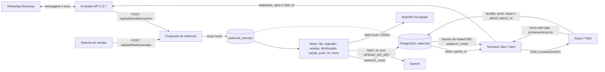
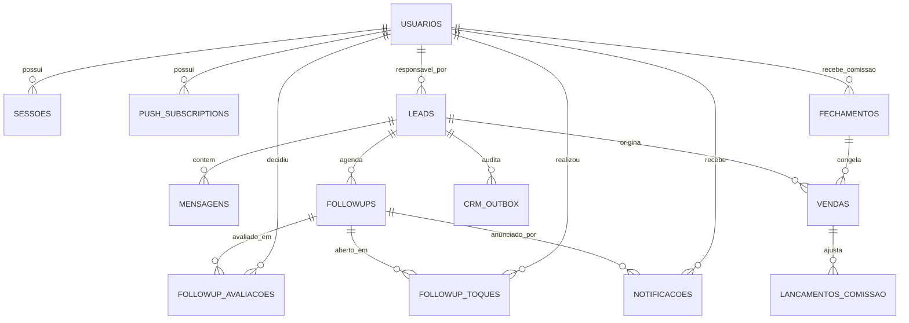

# Arquitetura atual do WakeCRM (Wake Club Dashboard)

> Snapshot da Fase 0 em 11/08/2026, revisado em 05/11/2026 para as fases 1 a 4 do WakeCRM.
> As seções descrevem o código do checkout; o que depende de captura ou de decisão do dono
> está marcado como pendente.
>
> **Estado em 05/11/2026:** as fases 1 a 4 (motor próprio, IA e follow-up com aprovação,
> interface nova e dinheiro) estão **implementadas localmente e não publicadas**. Os
> workflows n8n estão parados e **nunca rodam em paralelo com o motor**; as exportações
> estão em `docs/n8n-legado/` (só fonte de lógica). O adaptador da Evolution API 2.3.7
> (`src/server/evolution/`) existe e liga com `EVOLUTION_URL`, `EVOLUTION_API_KEY` e
> `EVOLUTION_INSTANCIA`; falta validá-lo com envio real (Task 13). A IA depende de
> `OPENAI_API_KEY`. O formato do webhook de vendas é provisório. Desenhos:
> `docs/superpowers/specs/` (motor próprio, fases 2-3, interface, fase 4); planos em
> `docs/superpowers/plans/`.

## Resumo executivo

O dashboard é uma aplicação TanStack Start que apresenta o CRM em PostgreSQL. O mesmo
processo também hospeda o motor que antes era o n8n: fila de webhooks, ingestão,
distribuição, saúde do número, notificações, transcrição, qualificação, redação e envio de
follow-ups, processamento de vendas e ritmo. O navegador nunca acessa o banco: as rotas
React chamam `createServerFn`, e os módulos de `src/server/` usam três roles (`painel_ro`
para views, `painel_rw` para as exceções de escrita do painel e `wakecrm_motor` para o
motor e para tudo que é do WakeCRM).

O produto atual tem:

- login próprio e autorização por `admin`/`atendente`, com início diferente por papel;
- conversas com linha do tempo, autoria e sugestão da IA; envio pelo app (precisa do
  adaptador);
- fila "Para avaliar" (`/aprovar`): nenhum follow-up sai sem um humano tocar "Enviar";
- Visão geral e Pipeline em reais (valor cheio e esperado), Equipe e Configurações e
  operação do admin;
- vendas por webhook, categorias, comissão congelada e fechamento do dia 10;
- PWA sem cache offline e Web Push; shell com barra lateral (desktop) e abas (celular);
  tema verde/rosa, modo claro/escuro e densidade por navegador.

O modelo continua centrado em `leads`. Não existem as tabelas `opportunities`, `contacts`
ou `followup_feedback` do plano antigo de refatoração; a avaliação humana do follow-up mora
em `followup_avaliacoes`.

## Contexto do sistema



Os webhooks e o motor vivem no mesmo processo Nitro do painel. Envio (pelo app e o dos
follow-ups aprovados), download de mídia, transcrição e heartbeat dependem do adaptador da
Evolution API (`src/server/evolution/`), ativo só com as três variáveis `EVOLUTION_*`.

Responsabilidade operacional:

- **motor** (`MOTOR_ATIVO=1`): ingere mensagens, distribui leads, mantém a saúde do número
  e a fila de notificações, transcreve áudios, qualifica leads, redige follow-ups, envia os
  aprovados, expira o que ficou sem decisão, processa vendas e devolve o ritmo aquecido ao
  conservador. Detalhe em "Motor".
- **dashboard:** lê o CRM, autentica a equipe, registra inscrições e aberturas, grava a
  decisão humana sobre cada sugestão, envia mensagens pelo app (quando houver adaptador) e
  entrega Web Push.
- **atendente (vendedor):** decide se edita e se envia o texto. A mensagem enviada pelo app
  grava autoria; a enviada pelo celular do número chega como eco e é marcada `celular`.
- **n8n:** desligado de vez; histórico em `docs/n8n-legado/`.

## Stack e execução

| Camada            | Implementação atual                                                              |
| ----------------- | -------------------------------------------------------------------------------- |
| Interface         | React 19, TanStack Router/Start, TanStack Query, Tailwind v4 e shadcn/ui         |
| Servidor          | TanStack Start com Nitro; entrada em `src/server.ts`                             |
| Motor             | trabalhador da fila e tarefas agendadas no mesmo processo; boot por plugin Nitro |
| IA                | cliente OpenAI por `fetch`, sem SDK (`src/server/ia/openai.ts`)                  |
| Banco             | PostgreSQL 14, schema `wakeclub`, driver `pg`                                    |
| Validação         | Zod nas fronteiras de server functions e API                                     |
| Autenticação      | bcrypt, cookie HttpOnly e token persistido como SHA-256                          |
| PWA/Push          | manifest, service worker nativo e `web-push` com VAPID                           |
| Build             | Bun + Vite; saída em `.output/`                                                  |
| Container         | Bun Alpine, usuário não-root `bun`, porta 3000                                   |
| Publicação        | GitHub Actions publica no GHCR em push para `main`, tags `v*` ou despacho manual |
| Produção descrita | Docker Swarm/Portainer, Traefik e rede externa `NovaNet`                         |

Dependências externas necessárias:

- PostgreSQL do CRM `wakeclub`;
- Evolution API 2.3.7 para WhatsApp e mídia (substitui o Evolution Go, decisão de 04/11/2026;
  adaptador em `src/server/evolution/`);
- OpenAI (chat para qualificar e redigir, transcrição de áudio), só com `OPENAI_API_KEY`;
- sistema de vendas, que chama `POST /api/webhooks/vendas` (formato provisório);
- provedores Web Push dos navegadores;
- GHCR, Docker Swarm/Portainer e Traefik para publicação.

Publicação em produção: `deploy/instalar.sh`, rodado como root no manager do Swarm
(`bash <(curl -fsSL https://raw.githubusercontent.com/felip2ee/dash-wakeclub-crm-wpp/main/deploy/instalar.sh)`).
Ele detecta Postgres, Traefik (rede e certresolver), Evolution API e Portainer, gera os
segredos em `/root/wakecrm/credenciais.env` (600, reaproveitado nas execuções seguintes) e,
com migração pendente, escala o CRM a 0, faz `pg_dump` em `/root/wakecrm/backups/`, roda
`db:migrate` e `db:apply` e restaura o backup sozinho se algo falhar. Depois cria o admin,
publica a stack `wakecrm` (serviço `wakecrm_wakecrm`, modelo `deploy/wakecrm-stack.yml`)
pela API do Portainer quando o dono informa a credencial, senão por `docker stack deploy`,
e confere réplica `Running`, `/login` 200 e `POST /api/webhooks/evolution` sem segredo = 404.
O ambiente do serviço nunca recebe `ADMIN_DATABASE_URL` nem a senha do superusuário; o motor
sai desligado (`MOTOR_ATIVO` vazio, sem `OPENAI_API_KEY`). Contrato:
`docs/superpowers/specs/2026-11-04-wakecrm-instalador-design.md`.

Variáveis consumidas pelo dashboard:

| Variável                    | Consumidor                                    | Finalidade                                                                                                       |
| --------------------------- | --------------------------------------------- | ---------------------------------------------------------------------------------------------------------------- |
| `DATABASE_URL`              | `src/server/db.ts`                            | conexão `painel_ro`, forçada read-only                                                                           |
| `DATABASE_URL_RW`           | `src/server/db.ts`                            | conexão limitada `painel_rw`                                                                                     |
| `VITE_VAPID_PUBLIC_KEY`     | cliente e servidor                            | chave pública da inscrição push                                                                                  |
| `VAPID_PRIVATE_KEY`         | servidor                                      | assinatura Web Push                                                                                              |
| `PUSH_DISPATCH_SECRET`      | rota de push                                  | autenticação da rota `POST /api/push/enviar` (legado do WF-09)                                                   |
| `DATABASE_URL_MOTOR`        | `src/server/db.ts`                            | role `wakecrm_motor`. **Obrigatória** mesmo com o motor desligado: vários leitores do painel a usam (ver abaixo) |
| `WAKECRM_MOTOR_PASSWORD`    | `scripts/migrar.mjs`                          | cria/redefine a senha da role do motor; igual à da URL                                                           |
| `MOTOR_ATIVO`               | `nitro-plugin.ts`                             | `1` liga fila e tarefas neste processo; vazio desliga                                                            |
| `WEBHOOK_EVOLUTION_SECRET`  | `webhooks/receber.ts`                         | segredo do webhook da Evolution; ausente = 404                                                                   |
| `WEBHOOK_VENDAS_SECRET`     | `webhooks/receber.ts`                         | segredo do webhook de vendas; ausente = 404                                                                      |
| `EVOLUTION_INSTANCIA`       | `evolution/index.ts`, `motor/iniciar.ts`      | nome da instância nas rotas REST e no heartbeat; obrigatória para o adaptador existir                            |
| `EVOLUTION_URL`             | `evolution/index.ts`                          | URL interna da Evolution API 2.3.7 no Swarm; detectada e gravada pelo instalador; obrigatória para o adaptador   |
| `EVOLUTION_API_KEY`         | `evolution/api.ts`                            | `AUTHENTICATION_API_KEY` da Evolution API, só no header `apikey`; obrigatória para o adaptador                   |
| `OPENAI_API_KEY`            | `ia/openai.ts`                                | chave da OpenAI. Ausente: qualificador, redator e transcrição ficam de fora (log `ia.sem_chave`); nada quebra    |
| `OPENAI_MODELO_TRANSCRICAO` | `ia/openai.ts`                                | modelo de transcrição; padrão `whisper-1`                                                                        |
| `ADMIN_DATABASE_URL`        | `scripts/painel-db.mjs`, `scripts/migrar.mjs` | roles, views e migrações; não usada pela aplicação                                                               |
| `PAINEL_RO_PASSWORD`        | `scripts/painel-db.mjs`                       | configuração da role de leitura                                                                                  |
| `PAINEL_RW_PASSWORD`        | `scripts/painel-db.mjs`                       | configuração da role limitada de escrita                                                                         |

## Organização do código

```text
src/
├── routes/        páginas, loaders, guards e rotas HTTP (push e webhooks)
├── server/        createServerFn e SQL server-only
│   ├── motor/     fila, agenda, ingestão, distribuição, saúde, notificações, boot,
│   │              transcrição, qualificador, redator, ritmo, envio de follow-ups, vendas
│   ├── ia/        contrato do cliente de IA, cliente OpenAI, cliente falso e prompts
│   ├── evolution/ tipos (incl. ErroEnvio), adaptador da Evolution API 2.3.7 e fixtures sintéticas
│   ├── vendas/    normalizador provisório do webhook de vendas e regras de categoria/comissão
│   └── webhooks/  recepção autenticada que grava o corpo bruto na fila
├── features/      aprovacao, configuracoes, conversa, conversas-lista, dinheiro, minha-fila,
│                  pipeline, preferencias, visao-geral, admin, respostas-rapidas, opportunities
├── components/    shell (AppShell, BarraLateral, BarraInferior, MenuUsuario), ui (shadcn e
│                  CardDegrade, ChipTemperatura, AvatarIniciais) e PWA
├── lib/           formatação, pipeline (agrupador por etapa), push cliente e erros
├── start.ts       middleware global de erro
└── server.ts      entrada Nitro e normalização de falhas SSR
```

`db/migrations/` guarda o schema (`0001_base`, `0002_motor`, `0003_virada`,
`0004_ia_followup`, `0005_vendas`); o runner é `scripts/migrar.mjs`.

`src/server/db.ts` é o único módulo que importa `pg` (pools `getPool`, `getPoolRw`,
`getPoolMotor` e `getPoolWebhook`, este só do endpoint de webhook). `vite.config.ts` inclui os
módulos com `createServerFn` em `importProtection.client.excludeFiles`; `db.ts` não é
excluído e, portanto, não pode chegar ao bundle cliente.

O shell (`src/components/shell/`, montado por `src/routes/__root.tsx`) mostra a barra
lateral no desktop e as abas inferiores no celular, com itens por papel definidos em
`navegacao.ts`. O antigo `AppSidebar.tsx` foi substituído.

### Shell, navegação e preferências

- **Admin, desktop:** Visão geral `/visao-geral`, Pipeline `/pipeline`, Conversas `/`,
  Follow-ups `/aprovar`, Vendas e comissões `/vendas`, Equipe `/equipe`, Configurações
  `/configuracoes`. **Admin, celular (abas):** Início (`/visao-geral`), Conversas, Pipeline,
  Config.
- **Atendente (desktop e celular, as mesmas quatro entradas):** Início `/inicio`, Conversas
  `/meus-leads`, Follow-ups `/aprovar`, Perfil `/perfil`.
- **Redirecionamento por papel:** `rotaInicial(papel)` manda o admin para `/visao-geral` e o
  atendente para `/inicio`; vale após o login e quando um papel abre a página do outro.
  `/inicio` redireciona o admin; `/meus-leads` redireciona o admin para `/kanban`;
  `/followups` redireciona o admin para `/wf02?aba=followups`.
- **Preferências** (`src/features/preferencias/`): tema (`verde` ou `rosa`), modo (`sistema`,
  `claro`, `escuro`) e densidade (`grande`, `medio`, `pequeno`) ficam em `localStorage`, na
  chave `wakecrm.preferencias`, e vão ao `<html>` como `data-tema`, `data-densidade` e a
  classe `.dark`. Um script inline no `<head>` aplica antes da hidratação para não piscar.
  Valem só para o navegador em que foram escolhidas. Tokens em `docs/design.md`.

## Rotas e superfícies HTTP

Rotas novas (WakeCRM):

| Rota                           | Acesso                                           | Dados/ação principal                                                                      |
| ------------------------------ | ------------------------------------------------ | ----------------------------------------------------------------------------------------- |
| `/aprovar`                     | sessão (admin vê todas as filas, filtra por vendedor) | fila "Para avaliar": `listarFilaAprovacao`, `decidirFollowup`                        |
| `/inicio`                      | atendente                                        | "Meu painel": `getPainelVendedor` (pode entrar, garantida, a pagar dia 10, ranking semanal) |
| `/perfil`                      | sessão                                           | preferências do navegador e sair                                                          |
| `/visao-geral`                 | admin                                            | KPIs em reais, vendas por categoria, pipeline por etapa, ranking, vendas recentes, alertas |
| `/pipeline`                    | admin                                            | `getPipeline` somente leitura: valor cheio e esperado por etapa                           |
| `/configuracoes`               | admin                                            | tamanho/tema, usuários, modo de follow-up, preço da hora, status do WhatsApp, fila de eventos, painel de IA, vendas sem dono |
| `/equipe`                      | admin                                            | cartões da equipe: peso de distribuição e comissão                                        |
| `/vendas`                      | admin                                            | vendas do período, vendas sem dono (vincular), fechamento do mês, estorno manual          |

Rotas anteriores, ainda acessíveis por URL:

| Rota                           | Acesso                                           | Observação                                                    |
| ------------------------------ | ------------------------------------------------ | ------------------------------------------------------------- |
| `/login`                       | pública                                          | `entrar`, com redirecionamento por papel                      |
| `/`                            | admin                                            | conversas, agora com linha do tempo, autoria e sugestão da IA |
| `/kanban`                      | admin                                            | `getLeadsPainel` e histórico                                  |
| `/wf02`                        | admin                                            | auditoria da IA antiga (`getPainelWf02`)                      |
| `/reports`                     | admin                                            | quatro views agregadas                                        |
| `/admin`                       | admin                                            | resumo, atendentes, aparelhos, monitor da fila, correção de dono |
| `/followups`, `/minha-fila`    | atendente (`/followups` redireciona o admin)     | fila antiga que abre o WhatsApp (`registrarToque`)            |
| `/meus-leads`                  | atendente                                        | conversas dos leads atribuídos, com sugestão da IA            |
| `/instalar`                    | usuário autenticado                              | instalação PWA, permissão e inscrição push                    |
| `/templates`                   | admin                                            | respostas rápidas (`respostas-rapidas.ts`)                    |
| `POST /api/push/enviar`        | segredo                                          | valida payload e chama `entregarPush`                         |
| `POST /api/webhooks/evolution` | segredo (header `x-webhook-secret` ou `?token=`) | grava o corpo bruto em `webhook_eventos` com chave de ordem  |
| `POST /api/webhooks/vendas`    | idem                                             | grava o corpo bruto em `webhook_eventos`                      |

O corpo da Evolution é gravado sem o `apikey` de nível superior (chave global da API); a migração `0006` limpa linhas antigas. Os webhooks respondem 404 com segredo inválido ou ausente, 400 para JSON inválido e 413
acima de 25 MB (nesse caso fica uma linha `falhou` com o tamanho, sem o corpo).

O cartão "Webhooks" de `/configuracoes` (só admin, `getWebhooks` em `configuracoes.ts`) mostra a
URL pública de cada webhook, montada pelos cabeçalhos `X-Forwarded-*`, o segredo e a URL com
`?token=`, para colar na Evolution e no sistema de vendas. Os segredos saem só nessa resposta.

As operações `createServerFn` são RPCs gerados pelo TanStack Start, não endpoints REST de
domínio mantidos manualmente.

## Módulos server-only

| Módulo                 | Funções expostas                                                                | Fonte de dados / escrita                                                                         |
| ---------------------- | ------------------------------------------------------------------------------- | ------------------------------------------------------------------------------------------------ |
| `db.ts`                | `getPool`, `getPoolRw`, `getPoolMotor`, `getPoolWebhook`, `comTransacao`        | cria os quatro pools PostgreSQL                                                                  |
| `log.ts`               | `logErro`, `logInfo`                                                            | único lugar com `console`; sem texto de conversa nem segredo                                     |
| `admin-motor.ts`       | monitor da fila, reprocesso, peso/comissão, correção de dono                    | `webhook_eventos`, `usuarios`, `leads`; exige admin                                              |
| `admin-ia.ts`          | `getPainelIa`, `getRitmo`, `definirRitmoAdmin`, `registrarExecucao`             | `configuracoes`, `followups`, `leads`; aquecido exige confirmação                                |
| `configuracoes.ts`     | `getConfiguracoes`, `definirPrecoHora`                                          | `configuracoes` (`preco_hora`)                                                                   |
| `aprovacao.ts`         | `listarFilaAprovacao`, `listarVendedoresAprovacao`, `decidirFollowup`           | `followups`, `followup_avaliacoes`, `eventos_automacao`; posse conferida no servidor             |
| `visao-geral.ts`       | `getVisaoGeral`                                                                 | alertas de operação + `getPipeline` + `lerResumoDinheiro`                                        |
| `dinheiro.ts`          | `getResumoDinheiro`, `getPainelVendedor`, `getRankingSemanal`                   | `vendas`, `fechamentos`, `leads`; vendedor só vê o próprio dinheiro                              |
| `vendas.ts`            | `listarVendas`, `listarVendasSemDono`, `vincularVenda`, `estornarVenda`         | `vendas`; admin                                                                                  |
| `fechamento.ts`        | `getFechamento`, `marcarPago`, `listarLancamentos`                              | `fechamentos`, `lancamentos_comissao`; admin                                                     |
| `respostas-rapidas.ts` | listar ativas, listar todas, salvar, remover                                    | `respostas_rapidas` via `wakecrm_motor`                                                          |
| `envio.ts`             | envio de texto e mídia pelo app                                                 | confere posse, chama o adaptador, grava `mensagens` com autoria; indisponível sem adaptador      |
| `motor/*`              | `iniciarMotor`, `pararMotor`, `rodarFila`, `agendar`, ingestão, tarefas de IA   | role `wakecrm_motor`; ver "Motor"                                                                |
| `ia/*`                 | `criarClienteOpenAi`, cliente falso, prompts                                    | `fetch` para a OpenAI; sem SDK                                                                   |
| `webhooks/receber.ts`  | `receberWebhook`, `enfileirar`                                                  | INSERT em `webhook_eventos`                                                                      |
| `evolution/`           | `obterAdaptador`, `chaveDeOrdemEvolution`, `normalizarEvolution`, `ErroEnvio`   | REST da Evolution API (`sendText`, `sendMedia`, `sendWhatsAppAudio`, `sendLocation`, mídia, estado) |
| `auth.ts`              | `entrar`, `getSessao`, `sair`, `exigirSessao`, `exigirAdmin`, `exigirAtendente` | `usuarios`, `sessoes`, `v_sessao_valida`                                                         |
| `leads.ts`             | `getLeadsPainel`, `getPipeline`                                                 | `v_leads_painel` + extras (horas, temperatura, preço da hora) pelo pool do motor                 |
| `conversas.ts`         | `getConversas`, `getMensagens`, `getLinhaDoTempo`, `leadsComSugestao`           | views de conversa/mensagem/autoria; linha do tempo e sugestão pelo pool do motor, posse no SQL   |
| `meus-leads.ts`        | `listarMeusLeads`, `listarMensagensDoMeuLead`                                   | views filtradas por usuário + `leadsComSugestao` (pool do motor)                                 |
| `wf02.ts`              | `getWf02Atividade`, `getWf02Motor`, `getFollowups`, `getPainelWf02`             | views do WF-02, followups e leads (legado)                                                       |
| `relatorios.ts`        | `getRelatorios`                                                                 | quatro views de relatório                                                                        |
| `saude.ts`             | `getSaudeNumero`                                                                | `v_saude_numero`                                                                                 |
| `followups.ts`         | `listarMinhaFila`, `registrarToque`                                             | `v_followups_fila`; INSERT em `followup_toques` após validar posse                               |
| `push.ts`              | chave pública, inscrição e push de teste                                        | `push_subscriptions`                                                                             |
| `admin.ts`             | painel, alteração/cadastro de atendente, remoção de aparelho e push de teste    | views admin, `usuarios`, `push_subscriptions`                                                    |
| `push-dispatch.ts`     | `entregarPush`                                                                  | aparelhos ativos; atualiza falhas/uso e remove inscrições 404/410                                |

**Leitores que passaram a usar o pool do motor.** `v_eventos_automacao_painel` não existe
(ficou fora da 0001) e `painel_ro` não lê `followups`. Por isso `getPipeline`,
`getLinhaDoTempo`, `leadsComSugestao` (usada por `getConversas` e `listarMeusLeads`) e
`listarMeusLeads` leem pelo pool `getPoolMotor()`, com a posse do vendedor no próprio SQL.
Consequência: `DATABASE_URL_MOTOR` é obrigatória para o painel funcionar, mesmo com
`MOTOR_ATIVO` vazio. A afirmação antiga de que os leitores usam só views não vale mais.

## Motor

Código em `src/server/motor/`, banco pela role `wakecrm_motor` (`getPoolMotor()`).

**Boot e parada.** `nitro-plugin.ts` roda no start do Nitro, antes de qualquer requisição, e
só chama `iniciarMotor()` com `MOTOR_ATIVO=1`. O `src/server.ts` carrega sob demanda, então
ligar o motor ali deixaria um restart sem tráfego com a fila parada. `iniciarMotor()` é
idempotente (guarda em `globalThis`). No encerramento (hook `close` do Nitro ou
SIGTERM/SIGINT) o plugin chama `pararMotor()`: para os timers, espera as rodadas em curso
por até 8 s e fecha os pools do motor e do webhook (teto de 0,5 s); se ainda assim o
processo não sair, força a saída em 9 s. Rodada presa no meio é coberta pelo lease do
qualificador e pelo órfão do envio.

**Adaptador da Evolution API 2.3.7** (`src/server/evolution/`). `obterAdaptador()` só
devolve o adaptador com `EVOLUTION_URL`, `EVOLUTION_API_KEY` e `EVOLUTION_INSTANCIA`
definidas (memoizado no processo); sem elas devolve `null` e nada é simulado.

- `normalizar.ts` porta o WF-01 e o WF-07: `messages.upsert` vira mensagem (E.164 com o 9º
  dígito, `@lid` pelo `remoteJidAlt`/`senderPn`, desembrulho de efêmera, visualização única,
  documento com legenda e editada, inclusive o `protocolMessage.editedMessage` do Baileys; mídia sem legenda vira `[imagem]`, `[audio]` etc.);
  grupo, status, canal e `@lid` sem número são ignorados. `messages.update`/`messages.edited`
  viram ack (0 a 5); `connection.update`, `application.startup`, `qrcode.updated`,
  `logout.instance` e `remove.instance` viram evento de conexão. O `apikey` do envelope
  nunca vai para `detalhe` nem log, e o QR em si não é guardado.
- `chave_ordem`: telefone E.164 da conversa (ou o JID sem número) para mensagens e acks;
  o ack de `@lid` resolve o número pelos mesmos campos da mensagem (`remoteJidAlt`/`senderPn`),
  `instancia:<nome>` para eventos da instância, `evolution` quando nada é reconhecível.
- `api.ts`: `POST /message/sendText|sendMedia|sendWhatsAppAudio|sendLocation/{instancia}`
  com `number` só em dígitos; `POST /chat/getBase64FromMediaMessage/{instancia}` para mídia
  (400/404 = sem mídia); `GET /instance/connectionState/{instancia}`. Chave só no header
  `apikey`. Timeout de 30 s (texto e localização), 120 s (mídia) e 15 s (estado).
  `ErroEnvio` `nao_saiu` só quando a recusa é provadamente anterior ao envio: 401/403
  (chave), 404 (instância) e 400 com corpo de validação do schema (`response.message[0]` é
  lista) ou de número fora do WhatsApp (`exists: false`). Qualquer outro 400 pode vir do
  `catch` de `sendMessageWithTyping`, que cobre o envio e o que roda depois dele; esse 400,
  os demais 4xx, timeout, rede, 5xx e resposta sem `key.id` são `incerto`. Mensagens de erro
  não levam corpo da resposta, URL nem chave.
- Fixtures sintéticas em `src/server/evolution/fixtures/` (sem dado real) cobrem cada caso.

**Fila.** Os endpoints só inserem em `webhook_eventos`. O trabalhador roda a cada 2 s,
reivindica até 4 cabeças com `FOR UPDATE SKIP LOCKED` (sem trava global; é seguro entre
réplicas) e processa cada evento na própria transação.

- Eventos da mesma `chave_ordem` (a conversa) saem em sequência estrita: só a cabeça da
  chave é elegível, e uma cabeça em `processando` ou com retentativa futura segura a
  chave. Chaves diferentes rodam em paralelo.
- Falha: até 5 tentativas, com esperas de 30, 120, 600 e 1800 s; na quinta o status é
  `falhou`, visível no monitor do admin e reprocessável (`reprocessar`). `ErroPermanente`
  falha sem retentar.
- Órfãos: `processando` há mais de 15 min volta a `pendente`.
- Origem sem processador não é reivindicada: sem adaptador, eventos da Evolution ficam
  `pendente` (gravados, não processados). As vendas têm processador próprio e não dependem
  do adaptador.
- Corpo acima de 25 MB: 413 e linha `falhou` com tamanho e erro.

**Tarefas agendadas** (`agenda.ts`: intervalo fixo, uma execução por vez, trava advisory no
banco), registradas em `iniciar.ts`. Toda tarefa grava a última execução em
`configuracoes.tarefas_execucao`, que o painel de IA do admin mostra.

| Tarefa              | Intervalo | Condição                    | O que faz                                                            |
| ------------------- | --------- | --------------------------- | -------------------------------------------------------------------- |
| fila                | 2 s       | sempre                      | `rodarFila` em laço até esvaziar (evolution só com adaptador)        |
| `orfaos`            | 5 min     | sempre                      | `devolverOrfaos` (eventos presos em `processando`)                   |
| `distribuicao`      | 5 min     | sempre                      | `soltarDeInativos` + `redistribuirSoltos` numa transação             |
| `push`              | 1 min     | sempre                      | `enviarPushPendentes` (fila `notificacoes`, sem n8n)                 |
| `heartbeat`         | 5 min     | adaptador                   | `gravarHeartbeat` da instância                                       |
| `ritmo-meia-noite`  | 5 min     | sempre                      | aquecido ligado antes da meia-noite de São Paulo volta a conservador |
| `expirar-followups` | 5 min     | sempre                      | `aguardando_aprovacao` sem decisão até 19h59 vira `expirado`         |
| `envio-followups`   | 1 min     | adaptador                   | envia um follow-up aprovado por rodada                               |
| `qualificador`      | 1 min     | `OPENAI_API_KEY`            | qualifica até 8 leads vencidos                                       |
| `redator`           | 15 min    | `OPENAI_API_KEY`            | porteiro + redator dos follow-ups vencidos                           |
| `transcricao`       | 1 min     | `OPENAI_API_KEY` e adaptador | transcreve até 5 áudios por rodada                                  |

Sem a chave, `iniciar.ts` loga `ia.sem_chave` uma vez e segue; sem adaptador, as tarefas
que precisam dele ficam de fora.

**Distribuição.** Por peso entre vendedores ativos, com atribuição pegajosa (o lead que já
teve dono fica com ele enquanto estiver ativo) e menção na conversa. Toda mudança de dono
gera `assignment_changed` com o motivo (`rodizio`, `mencao`, `desativacao`, `admin`) e
preenche `leads.atribuido_por`.

**Ingestão.** `registrarMensagem` faz upsert do lead, insere a mensagem de forma
idempotente, trata opt-out (evento `opt_out`, lead vai a "Negociação encerrada"), toque e
eco, agenda a qualificação (`qualificar_apos` = agora + 2 min de debounce), cancela
follow-ups em aberto e distribui lead sem dono. Mensagem gravada pelo envio de um follow-up
leva `followup_id`. Hoje só processa o tipo `mensagem` do evento normalizado.

**Saúde e notificações.** `saude.ts` mantém `instancia_estado`/`instancia_eventos` a partir
de eventos de conexão, ack e heartbeat; `notificacoes.ts` cria a fila de push e a tarefa
`push` a entrega via `entregarPush`. O alvo e o total do push da fila de aprovação saem de
`followups`, não mais de `v_followups_fila`.

**Transcrição** (`transcricao.ts`, porta do WF-11). Reivindica áudios pendentes (até 5 por
rodada, no máximo 3 tentativas; `transcrevendo` há mais de 15 min volta a `pendente`),
baixa a mídia pelo adaptador, transcreve e substitui `mensagens.texto`; depois reenfileira
a qualificação do lead. Áudio da equipe também é transcrito.

**Qualificador** (`qualificador.ts`, porta do WF-02 mais horas estimadas). Reivindica até 8
leads com `qualificar_apos` vencido e põe um **lease de 15 min** em `qualificar_apos`: se o
processo cair no meio da chamada de IA, o lead volta sozinho. A conclusão só zera o relógio
se ele ainda é o do lease; mensagem que chegou durante a IA mantém o novo horário. A IA
devolve etapa, interesse, objeção, temperatura, data agendada, resumo, justificativa,
follow-up sugerido e `horasEstimadas` (1 a 8). O código valida (data inexistente ou
impossível é rejeitada) e grava ficha, `eventos_automacao` e `crm_outbox`. A requalificação
cancela follow-ups `pendente`, `aguardando_aprovacao` e `aprovado`.

**Redator** (`redator.ts` e `redator-sql.ts`, porta do WF-03). A cada 15 min, só na janela
das 8h às 19h59 (São Paulo) e enquanto houver cota do dia: as vagas que restam (até 10) vão
aos follow-ups vencidos de maior valor esperado (empate: o mais antigo). O porteiro decide
liberar, reagendar ou abortar; o redator escreve; `validarTexto` limpa o resultado
(links só da lista permitida, inclusive domínio nu sem `http`/`www`, sem emoji, sem
travessão, entre 10 e 600 caracteres) e o follow-up vai a `aguardando_aprovacao` com
`texto_sugerido` e `sugerido_em`. As avaliações humanas recentes entram no fim dos prompts.
Texto editado pelo humano **não** passa por `validarTexto` (decisão aceita: ele é o autor).

**Envio dos follow-ups** (`envio-followups.ts`). Um por rodada de 1 min, só na janela e
respeitando o intervalo do ritmo desde o último `enviado`. Gate de fila atrasada: se a fila
da Evolution tem evento pendente/processando há mais de 2 min, ou falha nos últimos 30 min,
o envio espera, porque sem os eventos em dia o motor não sabe se o lead respondeu. A
reivindicação (`enviando`) é commitada antes da chamada e o envio roda fora de transação.
O adaptador sinaliza `ErroEnvio` com `certeza`: `nao_saiu` volta o follow-up a `aprovado`
(até 3 tentativas); `incerto` (timeout, 5xx, resposta ilegível) ou qualquer erro não tipado
aborta o follow-up como "envio sem confirmação" e avisa o vendedor, nunca reenvia sozinho.
`enviando` há mais de 15 min é órfão e recebe o mesmo tratamento; por isso o timeout do
adaptador precisa ser muito menor que 15 min.

**Vendas** (`motor/vendas.ts`, origem `vendas` da fila). Ver "Vendas e dinheiro".

## Ciclo de vida do follow-up

```text
pendente ──(redator)──▶ aguardando_aprovacao ──(humano: Enviar)──▶ aprovado
   │                           │                                      │
   │                           ├─(humano: Não enviar)─▶ abortado      ├─(motor)─▶ enviando ─▶ enviado
   │                           └─(expirar, 19h59)─────▶ expirado      │               └─(órfão/incerto)─▶ abortado
   └─(porteiro: aborta)────────────────────────────────▶ abortado     └─(conversa andou)─▶ cancelado
```

Status: `pendente`, `aguardando_aprovacao`, `aprovado`, `enviando`, `enviado`, `cancelado`,
`abortado`, `expirado` (constraint da 0004). Existe no máximo um follow-up em aberto
(`pendente`, `aguardando_aprovacao`, `aprovado` ou `enviando`) por lead.

Quem muda o quê:

| Quem                      | Transição                                                                                         |
| ------------------------- | ------------------------------------------------------------------------------------------------- |
| qualificador              | cria o `pendente`; ao requalificar, cancela `pendente`/`aguardando_aprovacao`/`aprovado` (`cancelado`, "requalificacao: a conversa andou"), sem aviso ao vendedor |
| ingestão                  | mensagem nova do lead ou opt-out cancela `pendente`/`aguardando_aprovacao`/`aprovado` (`cancelado`, "conversa viva" ou "opt-out") e cancela a notificação pendente. `enviando` e `enviado` ficam como estão |
| redator (porteiro)        | `pendente` → `aguardando_aprovacao` (texto), reagenda ou `abortado` (o lead não precisa mais)      |
| vendedor (`decidir`)      | `aguardando_aprovacao` → `aprovado` ("Enviar", com ou sem edição) ou `abortado` ("recusado pelo vendedor"). Recusa após 19h59 do dia do texto é rejeitada com "expirou" |
| `expirar-followups`       | `aguardando_aprovacao` do dia anterior, ou a partir das 20h, vira `expirado`; cancela a notificação pendente |
| `envio-followups`         | `aprovado` → `enviando` → `enviado` (grava mensagem com `followup_id`); falhas: `aprovado` de novo (`nao_saiu`) ou `abortado` (`incerto`/órfão/sem texto) |

`aprovado` sem envio (por exemplo, sem adaptador ou fora da janela) acumula: expirar
`aprovado` com mais de 24 h está parqueado para decisão do dono.

## Fila de aprovação e avaliações

`/aprovar` mostra os cards `aguardando_aprovacao` do vendedor (o admin vê todos e filtra por
vendedor): lead, temperatura, etapa, horas, última mensagem e a "Sugestão da IA", editável.
Dois botões: **Enviar** (aprova, com o texto possivelmente editado) e **Não enviar** (abre a
folha de motivos). Cada decisão grava uma linha em `followup_avaliacoes` (`decisao`
`enviar`/`recusar`, `motivos[]`, `texto_livre`, `texto_original`, `texto_enviado`) e o
evento em `eventos_automacao`, na mesma transação, depois de conferir a posse do lead.

Motivos de recusa: Cedo demais, Tom errado, Já falei com ele, Repetiu assunto, Lead não
quer, Outro. Motivos de envio: Texto certo, Lead quente, Ajustei o texto, Outro. As
avaliações recentes (do vendedor, as recusas gerais da equipe e os textos que o vendedor
editou) voltam ao prompt do porteiro e do redator no bloco `{{AVALIACOES}}`.

## Ritmo, cota, janela e intervalo

Modo em `configuracoes.ritmo`; muda só o admin (`definirRitmoAdmin`, que registra
`rhythm_changed`; aquecido exige `confirmar: true`).

| Modo         | Cota de textos preparados por dia | Intervalo mínimo entre envios |
| ------------ | --------------------------------- | ----------------------------- |
| conservador  | 20                                | 120 s                         |
| aquecido     | 60                                | 45 s                          |

- **Cota:** conta os follow-ups com `sugerido_em` no dia de São Paulo; o redator só prepara
  enquanto houver vaga.
- **Janela:** preparo e envio só das 8h às 19h59 de São Paulo (`dentroDaJanela`).
- **Intervalo:** o envio espera o intervalo do modo desde o último `enviado_em`.
- **Aquecido** dura até a meia-noite de São Paulo; `ritmo-meia-noite` registra `rhythm_reset`
  e volta a conservador.
- **Valor esperado** (`motor/valor.ts`): horas × preço da hora × chance por etapa e
  temperatura (premissas do artefato de pipeline, não histórico). Ordena os vencidos do
  redator e alimenta Pipeline e Visão geral. Preço da hora em `configuracoes.preco_hora`
  (padrão 360).

## IA

Cliente em `src/server/ia/openai.ts`: `fetch` direto, sem SDK. Uma retentativa em 5xx,
timeout ou falha de rede. A chave vem só de `OPENAI_API_KEY` e nunca entra em mensagem de
erro; o erro (`ErroIa`) leva só status, código e tipo da OpenAI, sem o corpo. Os testes usam
o cliente falso (`ia/falso.ts`); as tarefas recebem o `ClienteIa` por parâmetro.

| Uso            | Modelo           | Esforço de raciocínio | Timeout | Prompt (`VERSAO_PROMPT`)            |
| -------------- | ---------------- | --------------------- | ------- | ----------------------------------- |
| qualificador   | `gpt-5.4-mini`   | low                   | 60 s    | `motor-qualificador-2026-11-04`     |
| porteiro       | `gpt-5.4-mini`   | low                   | 60 s    | `motor-porteiro-2026-11-04`         |
| redator        | `gpt-5.4`        | medium                | 90 s    | `motor-redator-2026-11-04`          |
| transcrição    | `OPENAI_MODELO_TRANSCRICAO` (padrão `whisper-1`), idioma `pt` | | 120 s | n/a                  |

Os prompts são os literais dos workflows n8n, portados sem reescrita para
`src/server/ia/prompts/` (`qualificador.ts`, `porteiro.ts`, `redator.ts`; `extrair.mjs`
regenera a partir das exportações). Cada arquivo exporta `VERSAO_PROMPT`, gravada junto da
decisão no evento de automação; mude a constante sempre que mudar o texto. A resposta usa
`response_format: json_schema` (sem `strict`, decisão aceita). Eventos de automação nunca
guardam prompt, raciocínio ou texto de conversa.

## Vendas e dinheiro

**Entrada.** `POST /api/webhooks/vendas` só enfileira. O processador `vendas` da fila
(`motor/vendas.ts`) normaliza com `vendas/normalizar.ts`. **O formato do webhook é
provisório**: o normalizador é tolerante (procura vários nomes de campo) e registra cada
suposição em `decisoes` no evento `sale_received`. Suposições atuais: valor com ponto de
milhar ("1.500") e inteiro acima de 1000 sem casas como centavos; telefone de 10 ou 11
dígitos ganha +55; CPF que não tem 11 dígitos é descartado; data ausente vale o horário de
recebimento; status ausente vale `paga`, `estornad|refund|chargeback|cancel` vira estornada e
outro valor é erro permanente; horas lidas do nome do produto. Calibre com o payload real
antes da virada.

**Idempotência e cruzamento.** `vendas` é única por `(origem_externa, id_externo)`;
reprocessar não recalcula, só um estorno novo muda a venda. O cruzamento com o lead é por
`leads.cpf` primeiro, depois por telefone; ao casar por telefone com CPF na venda, grava o CPF
no lead (se vazio). Venda sem casamento fica sem dono (`lead_id` nulo) e aparece em
"Vendas sem dono"; o admin vincula à mão (`vinculada_por = 'admin'`, com confirmação,
irreversível).

**Categorias** (`vendas/regras.ts`, janela de 48 h antes da compra): `follow-up` (follow-up
`enviado` na janela), `atendimento` (mensagem da equipe na janela), `recompra` (sem
interação, lead já tinha venda paga) e `espontanea` (nenhum dos três). O motivo fica em
`categoria_motivo`.

**Comissão congelada.** No vínculo, a venda grava `vendedor_id`, `comissao_pct` (de
`usuarios.comissao_pct` naquele momento) e `comissao_valor`, em centavos, com meio centavo
para cima. Só `follow-up` e `atendimento` pagam; mudar a % depois não altera vendas antigas.

**Fechamento do dia 10** (`fechamento.ts`). O mês aberto é calculado na hora: vendas
`paga` comissionáveis do mês de São Paulo mais os lançamentos pendentes do vendedor.
`marcarPago` só aceita meses encerrados, congela o mês num `fechamentos` pago (liga as
vendas via `fechamento_id`, consome os lançamentos) e usa trava advisory por
(vendedor, mês). Depois de pago o mês não muda: estorno de venda de mês pago, e venda
atrasada de mês pago, viram `lancamentos_comissao` (negativo ou positivo) no próximo
fechamento. **Saldo negativo vai adiante:** se `a_pagar` < 0, o fechamento registra pago 0
e cria um lançamento negativo pendente (`venda_id` nulo, motivo "saldo negativo de AAAA-MM")
para o mês seguinte. Na soma do admin, o a pagar por vendedor usa `max(0)`; no painel do
vendedor o valor é o líquido.

**Painéis.** `lerResumoDinheiro` (Visão geral e Pipeline): pipeline cheio/esperado, vendido
no período (só `paga`), categorias, a pagar no dia 10 e ranking. `getPainelVendedor`
("Meu painel"): *pode entrar* (valor esperado do pipeline do vendedor × sua %), *garantida
no mês* e *a pagar dia 10*. O ranking semanal (posição por `rank()`, inclui vendedores com
zero) é a única visão de outro vendedor; o resto do dinheiro é só do dono.

## Modelo de dados

### Entidades do CRM

| Tabela                 | Papel                                                         | Relações e observações                                                                                                                    |
| ---------------------- | ------------------------------------------------------------- | ----------------------------------------------------------------------------------------------------------------------------------------- |
| `leads`                | contato + oportunidade + estado comercial                     | telefone único; etapa em `etiqueta`; temperatura; responsável; relógio `qualificar_apos`; `opt_out`, `sem_atendimento`; `horas_estimadas` (0004, 1 a 8); `cpf` (0005, índice parcial) |
| `mensagens`            | histórico bruto da conversa                                   | N:1 com lead; direção `lead/equipe/ia`; idempotência por `evolution_msg_id`; ack; estado de transcrição; `followup_id` (0004)            |
| `followups`            | agenda e sugestão produzida pela IA                           | N:1 com lead; um em aberto por lead; motivo, `texto_sugerido`, `sugerido_em`, `texto_enviado`, `enviado_em`; 0004: `aprovado_em`, `aprovado_por`, `erro_envio`, `tentativas_envio` |
| `followup_avaliacoes`  | decisão humana sobre cada texto (0004)                        | N:1 com follow-up e usuário; `decisao`, `motivos[]`, `texto_livre`, `texto_original`, `texto_enviado`; alimenta os prompts; só INSERT   |
| `configuracoes`        | chave/valor do motor (0004)                                   | `ritmo`, `preco_hora`, `tarefas_execucao`; trigger de `atualizado_em`                                                                    |
| `vendas`               | venda recebida por webhook (0005)                             | única por `(origem_externa, id_externo)`; `lead_id`/`vendedor_id` nulos = sem dono; categoria, comissão congelada, estorno, `corpo_bruto` |
| `fechamentos`          | fechamento mensal por vendedor (0005)                         | único por `(vendedor_id, mes)`; `total_vendas` em reais, `quantidade_vendas`, `total_comissao`, `ajustes`, `a_pagar`, `pago_em/por`     |
| `lancamentos_comissao` | ajustes entre meses (0005)                                    | estorno pós-fechamento, venda atrasada, saldo negativo (`venda_id` nulo); consumido por um `fechamento_id`                              |
| `crm_outbox`           | trilha das qualificações e do opt-out                         | N:1 com lead; `tipo='qualificacao'` guarda payloads usados por `v_wf02_atividade`                                                         |
| `instancia_eventos`    | histórico append-only da saúde Evolution                      | chave lógica por instância e horário                                                                                                      |
| `instancia_estado`     | snapshot da saúde da instância                                | uma linha por instância; conexão, heartbeat e QR                                                                                          |
| `eventos_automacao`    | auditoria das decisões do motor                               | uma linha por decisão, no mesmo comando SQL que muda o dado; nunca guarda raciocínio, prompt ou conversa. `lead_id` é nulo só para entidade `config` (ritmo) ou `venda` (CHECK `lead_obrigatorio`); `entidade_tipo` ∈ lead, followup, config, venda |
| `webhook_eventos`      | fila de entrada dos webhooks (0002)                           | `origem` (`evolution`/`vendas`), `corpo jsonb`, `status`, `tentativas`, `proxima_tentativa_em`, `chave_ordem`; índice parcial nas abertas |

### Entidades da equipe

| Tabela               | Papel                                  | Relações e observações                                                                 |
| -------------------- | -------------------------------------- | -------------------------------------------------------------------------------------- |
| `usuarios`           | login, papel e estado da pessoa        | recebe leads, sessões, aparelhos e toques; `peso` e `comissao_pct` (0002); `senha_hash` server-only |
| `sessoes`            | sessões de 30 dias                     | N:1 com usuário; armazena hash do token e revogação                                    |
| `push_subscriptions` | aparelhos inscritos                    | N:1 com usuário; endpoint e chaves são sensíveis                                       |
| `notificacoes`       | fila persistente de push               | destinatário opcional; pode referenciar followup; status inclui `cancelada`; entregue pela tarefa `push` |
| `followup_toques`    | log de abertura do WhatsApp (fluxo antigo) | N:1 com followup e usuário; append-only                                            |
| `whatsapp_labels`    | catálogo retornado por `findLabels`    | não prova labels por conversa; legado/decorativo                                       |
| `respostas_rapidas`  | textos prontos por `/atalho` (0002)    | cadastro do admin em `/templates`; leitura por qualquer sessão (só ativas)             |
| `migracoes`          | registro das migrações aplicadas       | por `scripts/migrar.mjs`; cada arquivo roda numa transação e é registrado uma vez      |

### Relações principais



Migrações em ordem: **0001** base; **0002** motor (`webhook_eventos`, `respostas_rapidas`,
`usuarios.peso/comissao_pct`, `leads.atribuido_por`, `mensagens.usuario_id/enviada_por`);
**0003** corte da virada (destrutiva, ver `docs/runbook-virada.md`); **0004** IA e follow-up
(`leads.horas_estimadas`, `configuracoes`, novos status e colunas de `followups`,
`mensagens.followup_id`, `followup_avaliacoes`, `eventos_automacao` aceitando `config`);
**0005** vendas (`leads.cpf`, `vendas`, `fechamentos`, `lancamentos_comissao`,
`eventos_automacao` aceitando `venda`). A 0004 e a 0005 seguem a 0003 no mesmo
`db:migrate`: não podem ir antes dela (ver o runbook). Reaplicar a 0004 depois da 0005 devolve
as constraints de `eventos_automacao` à versão da 0004; o runner aplica cada arquivo uma vez.

Mensagens enviadas pelo app (`src/server/envio.ts`) levam autoria; as anteriores à virada
não têm, e o autor não é inventado. Métricas antigas por atendente continuam calculadas
pelo lead atribuído.

## Views expostas ao dashboard

| View                         | Finalidade                                                  | Consumidor atual              |
| ---------------------------- | ----------------------------------------------------------- | ----------------------------- |
| `v_leads_painel`             | card do funil, responsável, espera e followup pendente      | Kanban, Pipeline, Meus Leads  |
| `v_saude_numero`             | snapshot e alerta da Evolution                              | shell global                  |
| `v_conversas_painel`         | inbox com última mensagem e contagens                       | `/`, Meus Leads               |
| `v_mensagens_painel`         | thread com texto e ack                                      | `/`, Kanban e Meus Leads      |
| `v_mensagens_autoria`        | autoria da mensagem da equipe (0002, versionada)            | `/`, Kanban e Meus Leads      |
| `v_wf02_atividade`           | antes/depois das qualificações reconstruído do `crm_outbox` | `/wf02`                       |
| `v_wf02_motor`               | fila, retries suspeitos e órfãos do qualificador            | `/wf02`                       |
| `v_followups_painel`         | agenda e status dos followups                               | `/wf02`                       |
| `v_relatorio_resumo`         | KPIs gerais                                                 | `/reports`                    |
| `v_relatorio_funil`          | distribuição por etapa                                      | `/reports`                    |
| `v_relatorio_volume_dia`     | mensagens por dia                                           | `/reports`                    |
| `v_relatorio_wf02_dia`       | qualificações por dia                                       | `/reports`                    |
| `v_sessao_valida`            | sessão ativa sem expor senha                                | autenticação                  |
| `v_followups_fila`           | sugestão pendente, toques e eco separados                   | `/followups` (fluxo antigo)   |
| `v_admin_labels_disponiveis` | catálogo ainda não associado a usuário                      | `/admin`                      |
| `v_admin_atendentes`         | métricas por lead atribuído                                 | `/admin`                      |
| `v_admin_resumo`             | fila, toque, eco, abortos e distribuição                    | `/admin`                      |

As tabelas novas do WakeCRM (`configuracoes`, `followup_avaliacoes`, `vendas`, `fechamentos`,
`lancamentos_comissao`) não têm view: os leitores usam o pool do motor.

## Roles e privilégios

### `painel_ro`

- SELECT nas views acima e, pelas migrações 0004 e 0005, em `configuracoes`, `vendas`,
  `fechamentos` e `lancamentos_comissao` (cada concessão guardada pela existência da role);
- a conexão acrescenta `default_transaction_read_only=on`;
- não acessa as demais tabelas do CRM.

### `wakecrm_motor`

Criada por `scripts/migrar.mjs` quando `WAKECRM_MOTOR_PASSWORD` está definida; a 0002, a
0004 e a 0005 falham sem ela. Grants:

- SELECT/INSERT/UPDATE em `leads`, `mensagens`, `followups`, `crm_outbox`,
  `eventos_automacao`, `instancia_eventos`, `instancia_estado`, `notificacoes`,
  `webhook_eventos`, `configuracoes` (0004), `vendas`, `fechamentos` e
  `lancamentos_comissao` (0005);
- SELECT/INSERT em `followup_avaliacoes` (0004; as avaliações não se alteram);
- SELECT/INSERT/UPDATE/DELETE em `respostas_rapidas`;
- SELECT em `push_subscriptions` e `followup_toques`;
- SELECT em `v_followups_fila` quando a view existe (só em produção);
- SELECT por coluna em `usuarios` (sem `senha_hash`) e UPDATE de `peso`, `comissao_pct`
  e `ativo`;
- USAGE nas sequências do schema. Sem DELETE nas demais tabelas.

### `painel_rw`

- SELECT em `usuarios`, usado apenas no servidor para autenticação/admin, mais INSERT e
  UPDATE de `peso` e `comissao_pct` (0002);
- INSERT limitado ao cadastro de `usuarios` e UPDATE limitado a
  `ultimo_acesso_em`/`ativo`;
- SELECT/INSERT/UPDATE/DELETE em `sessoes` e `push_subscriptions`;
- INSERT em `followup_toques`;
- SELECT e UPDATE em `configuracoes` (0004). `definirPrecoHora` grava o preço da hora por
  esta role (o ritmo vai pelo pool do motor). A troca do preço não gera evento de
  auditoria, porque `painel_rw` não escreve em `eventos_automacao` (aceito; registrar na virada);
- SELECT de `leads.id/sem_atendimento/sem_atendimento_motivo` e UPDATE apenas das duas
  colunas de `sem_atendimento`;
- nenhuma leitura geral de `leads`, nenhum UPDATE de `etiqueta` ou `atendente_id`, nenhum
  acesso a dinheiro, `mensagens`, `followups`, `crm_outbox`, `notificacoes` ou saúde.

`scripts/painel-db.mjs` é a implementação executada por `db:apply` e `db:check`. As views do
painel e os GRANTs de `painel_ro`/`painel_rw` vêm de `db/painel-views.sql`, exportado do catálogo
de produção em 2026-11-04 (antes em `../db/`, fora do repositório). `v_mensagens_autoria` fica
na migração `0002`. `../db/painel-role.sql` não existe neste checkout.

## Workflows n8n (legado, parados)

Os arquivos exportados estão em `docs/n8n-legado/`; servem só como fonte para portar
lógica. A tabela descreve o comportamento original.

| Workflow           | Gatilho                                   | Função e efeitos principais                                                                                                                            |
| ------------------ | ----------------------------------------- | ------------------------------------------------------------------------------------------------------------------------------------------------------ |
| WF-01 Ingestor     | webhook Evolution                         | normaliza evento, faz upsert do lead, insere mensagem idempotente, registra movimento, cancela followup quando a conversa anda e agenda requalificação |
| WF-02 Qualificador | a cada minuto                             | reivindica `qualificar_apos`, lê conversa, usa OpenAI `gpt-5.4-mini`, valida decisão, atualiza o lead, grava qualificação no outbox e agenda followup  |
| WF-03 Redator      | a cada 15 minutos                         | reivindica followups vencidos sem texto, executa Porteiro (`gpt-5.4-mini`) e Redator (`gpt-5.4`), grava sugestão/notificação ou reagenda/aborta        |
| WF-07 Saúde        | eventos do WF-01 + heartbeat a cada 5 min | mantém `instancia_estado`, `instancia_eventos` e acks em mensagens                                                                                     |
| WF-08 Distribuição | a cada 5 minutos                          | atualiza catálogo de labels, solta leads de usuária inativa e distribui leads sem dona pelo menor volume, com atribuição pegajosa                      |
| WF-09 Push         | a cada minuto                             | cancela notificações obsoletas, reivindica e agrupa por destinatário, chama o endpoint do painel e marca envio/falha                                   |
| WF-11 Transcritor  | a cada minuto                             | reivindica áudios, baixa mídia pela Evolution, transcreve com OpenAI, substitui `mensagens.texto` e reenfileira qualificação                           |

Os arquivos `console-sql.js` e `console-evolution.js` são ferramentas manuais de
diagnóstico, não workflows para ativação contínua.

O checkout não contém implementação do WF-10 de requalificação. A existência de
`ESPEC-BOTAO-NAO-ATENDER.md` documenta o contrato, não prova que o webhook ou a ação do
dashboard estejam prontos.

### Fluxo de uma conversa até a ação humana (legado)

1. Evolution envia o evento ao WF-01.
2. WF-01 persiste lead/mensagem e move `qualificar_apos` para depois do debounce.
3. WF-02 qualifica, atualiza o estado do lead, registra o payload no outbox e pode criar
   um followup.
4. WF-03 avalia o followup quando vence e grava `texto_sugerido`; a IA não envia ao
   cliente.
5. WF-09 transforma a notificação válida em chamada ao endpoint push do dashboard.
6. A atendente abre `/followups`; o painel valida a posse, registra
   `followup_toques` e navega para `wa.me`.
7. Se a atendente enviar, o eco volta pela Evolution e o WF-01 registra a mensagem da
   equipe e encerra/cancela o followup conforme o fluxo existente.

## Componentes e comportamentos reutilizáveis

- `CardDegrade`, `ChipTemperatura` e `AvatarIniciais` (`src/components/ui/`) são os
  componentes do desenho novo; ver `docs/design.md`.
- Conversa: `src/features/conversa/` (`Bolha`, `Composer`, linha do tempo e sugestão da IA)
  é a renderização compartilhada de `/` e `/meus-leads`. O Kanban antigo e `/wf02` ainda têm
  as suas (`HistoricoDoLead`, `AbaTimeline`/`CardQualificacao`).
- `src/lib/pipeline.ts` agrupa leads por etapa (`agruparPorEtapa`, `precoHoraDe`): usado por
  `getPipeline`, Pipeline e Visão geral. `precoHoraDe` lança se o preço da hora não existe
  (CRM sem leads não exige preço).
- `src/lib/formato.ts` concentra datas, telefone, iniciais e pluralização.

## Base existente e regras vigentes do painel

### Base existente — não recriar

- Stack: TanStack Start, React 19, Vite, Nitro, TanStack Query, Tailwind v4,
  shadcn/ui, PostgreSQL via `pg`; gerenciador: Bun.
- Rotas ficam em `src/routes/`; servidor e SQL em `src/server/`; componentes não
  executam SQL.
- `src/server/db.ts` é o único módulo que importa `pg` ou lê URLs do banco.
- `getPool()` usa `painel_ro`; `getPoolRw()` usa a role limitada `painel_rw`;
  `getPoolMotor()` usa `wakecrm_motor` (motor e leitores do WakeCRM).
- Login, sessão por papel, PWA, push, fila individual, meus leads e admin já existem.
- `/templates` é o cadastro real de respostas rápidas; não existe dado de demonstração
  em tela operacional.

### Responsabilidade dos dados (WakeCRM)

Decisão do dono em 03/11/2026 (design do WakeCRM, §2): o app assume tudo que o n8n
fazia. Os workflows ficam desligados de vez; as exportações estão em
`docs/n8n-legado/` só como fonte para portar lógica. **n8n nunca roda em paralelo com o
motor.**

Quem escreve o quê:

- **Motor** (`src/server/motor/`, pool `getPoolMotor()`, role `wakecrm_motor`): fila
  `webhook_eventos`, leads, mensagens, distribuição (`leads.atendente_id`), followups,
  `eventos_automacao`, saúde do número, fila `notificacoes`, vendas, e as decisões de
  IA e de envio. Liga só com `MOTOR_ATIVO=1`.
- **Endpoints de webhook** (`/api/webhooks/*`): só gravam o corpo bruto em
  `webhook_eventos`, por um pool próprio (`getPoolWebhook()`, mesma role, máximo 4
  conexões) para um pico do motor (`getPoolMotor()`, máximo 12) não esgotar a gravação.
  Não processam nada na requisição.
- **Server functions do WakeCRM** (aprovação, ritmo, vendas, fechamento, dinheiro): usam
  `getPoolMotor()` e conferem papel e posse no servidor.
- **Envio pelo app** (`src/server/envio.ts`): chama a Evolution e grava a mensagem com
  autoria (`usuario_id`, `enviada_por = 'app'`). O envio dos follow-ups aprovados é do motor.
- **Telas antigas**: continuam lendo views com `painel_ro` e escrevendo o que a
  `painel_rw` já podia (sessões, push, toques, `usuarios`, `sem_atendimento`), mais
  `peso`, `comissao_pct` e o preço da hora.

Regras invioláveis:

1. Toda decisão do motor vira linha em `eventos_automacao` no mesmo comando SQL que
   muda o dado. Nunca guardar raciocínio do modelo, prompt ou texto de conversa lá.
2. A `wakecrm_motor` não lê `usuarios.senha_hash`; o grant é por coluna.
3. Toda tabela ou view nova exige grant explícito numa migração em `db/migrations/` e
   teste positivo/negativo no banco de teste (`bun run test:db`).
4. `usuarios.senha_hash` é estritamente server-only: nunca aparece em view, resposta,
   bundle, erro ou log.
5. Credenciais, URLs com senha, chaves VAPID, chave da Evolution, da OpenAI e segredos de
   webhook vivem somente em `.env`; `.env.example` contém apenas placeholders.
6. Segredo de webhook é comparado de forma resistente a timing; inválido ou ausente
   responde 404.
7. Vendedor só lê e responde lead atribuído a ele; lead sem dono só o admin. A posse é
   conferida no servidor em toda leitura e envio. Vendedor só vê o próprio dinheiro (o
   ranking semanal é a exceção).
8. **Nenhum follow-up sai sem um humano tocar "Enviar".** O motor só envia `aprovado`,
   reivindicado com `aprovado_por` preenchido, e re-confere opt-out e `sem_atendimento`.

### Semântica que não pode ser adulterada

- Mensagem da equipe tem três origens: `enviada_por = 'app'` (com `usuario_id`),
  `'celular'` (saiu do celular do número) e `null` (legado, anterior à virada). As telas
  de conversa leem a autoria de `v_mensagens_autoria` e mostram, sob a mensagem, o nome do
  autor, "enviado pelo ADM" ou "Equipe". Isso é só leitura no app. Não invente autor para
  mensagem legada.
- Métricas antigas por atendente são por lead atribuído, não por autoria de mensagem.
- "Abrir no WhatsApp" (`followup_toques`) significa **abriu**, nunca **enviou**; é o fluxo
  antigo (`/followups`, `/minha-fila`), mantido por URL. `followup_toques` é append-only.
- Lead que já teve dono é desse vendedor enquanto ele estiver ativo. Mudança de dono
  sempre gera `assignment_changed` com o motivo (`rodizio`, `mencao`, `desativacao`,
  `admin`); `leads.atribuido_por` guarda o último.
- Uma timeline só mostra fatos sustentados pelos dados; ausência de evento fica visível,
  não preenchida por inferência.
- Followup cancelado não é automaticamente erro; mostre o motivo disponível.
- Recusar uma sugestão não é `sem_atendimento`, não é opt-out e não remove o lead da
  distribuição.
- A etapa do lead só a IA move (Pipeline é somente leitura).
- As labels do WhatsApp não são fonte de dado.

### Estado das fases

Prontas localmente, **não publicadas**:

- **Fase 1:** fila com sequência por chave, ingestão, distribuição por peso e menção, saúde,
  notificações push, área de admin (monitor da fila, peso, comissão, correção de dono),
  respostas rápidas, composer de envio, migrações e o corte da virada.
- **Fases 2-3:** transcrição, qualificador com horas estimadas, porteiro e redator, ritmo,
  expiração, fila de aprovação com avaliações e envio dos aprovados.
- **Interface:** tokens, temas, densidade, shell novo e as telas de referência.
- **Fase 4:** vendas, categorias, comissão, fechamento do dia 10 e painéis em dinheiro.

Bloqueios: o fim da Task 13 da fase 1 (adaptador da Evolution API escrito; falta provar com
envio real, mídia, tamanho dos corpos, limite de 25 MB e de 16 MB nas server functions) e
`OPENAI_API_KEY`. Sem o adaptador, o webhook só grava bruto e envio, mídia,
transcrição e heartbeat ficam desligados; sem a chave, nada é qualificado nem redigido.
O formato do webhook de vendas é provisório (ver "Vendas e dinheiro").

## Estado validado na Fase 0 (histórico)

`bun run db:check` foi executado em 11/08/2026 contra o PostgreSQL real e confirmou
PostgreSQL 14.23, 68 leads, 1.262 mensagens, 110 followups, as 16 views legíveis por
`painel_ro` e os privilégios das duas roles. Não foram validados ao vivo: status dos
workflows n8n, versão da Evolution e entrega real de mensagem, push em aparelho físico,
imagem publicada no GHCR e a stack no Portainer. Nada das fases 1 a 4 foi validado em
produção.
