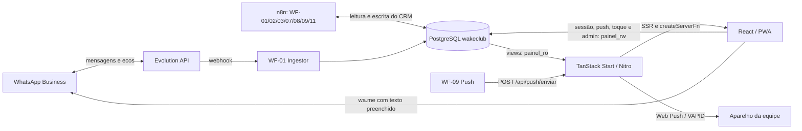
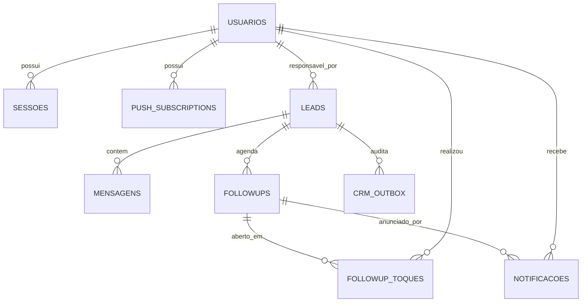

# Arquitetura atual do Wake Club Dashboard

> Snapshot da Fase 0 em 11/08/2026, revisado em 04/11/2026. Descreve o sistema
> existente; não antecipa a arquitetura desejada e não autoriza novas escritas.
>
> **Estado em 04/11/2026:** os workflows n8n descritos aqui estão **parados** e os
> arquivos deles não estão neste checkout (`../n8n/`, `../db/` e `../CLAUDE.md` não
> existem aqui). A arquitetura que vai substituí-los está em
> `docs/superpowers/specs/2026-11-03-wakecrm-motor-proprio-design.md`; até a fase 1
> dela ser entregue, as regras do fim deste documento continuam valendo.

## Resumo executivo

O dashboard é uma aplicação TanStack Start que apresenta o CRM mantido por workflows
n8n em PostgreSQL. O navegador nunca acessa o banco diretamente: as rotas React chamam
`createServerFn`, os módulos em `src/server/` consultam views com `painel_ro` e usam
`painel_rw` apenas nas exceções de escrita explicitamente concedidas.

O produto atual já possui:

- login próprio e autorização por `admin`/`atendente`;
- conversas, Kanban, auditoria do WF-02 e relatórios para admin;
- fila de followups e leads isolados por atendente;
- PWA sem cache offline e entrega Web Push;
- administração de atendentes e aparelhos;
- saúde da instância Evolution.

O modelo ainda é centrado em `leads`. Não existem hoje as tabelas `opportunities`,
`contacts`, `automation_events` ou `followup_feedback`, nem uma operação unificada para
carregar o workspace de uma oportunidade.

## Contexto do sistema



Responsabilidade operacional:

- **n8n:** ingere mensagens, qualifica, mantém campos do CRM, agenda/cancela followups,
  redige sugestões, distribui leads, gerencia a fila de notificações e chama serviços
  externos.
- **dashboard:** lê o CRM, autentica a equipe, registra inscrições e aberturas, entrega
  Web Push quando solicitado e abre o WhatsApp para a ação humana.
- **atendente:** decide se edita e se envia o texto. O toque no painel prova apenas a
  abertura; o eco recebido pelo WF-01 é a evidência de mensagem da equipe.

## Stack e execução

| Camada            | Implementação atual                                                              |
| ----------------- | -------------------------------------------------------------------------------- |
| Interface         | React 19, TanStack Router/Start, TanStack Query, Tailwind v4 e shadcn/ui         |
| Servidor          | TanStack Start com Nitro; entrada em `src/server.ts`                             |
| Banco             | PostgreSQL 14, schema `wakeclub`, driver `pg`                                    |
| Validação         | Zod nas fronteiras de server functions e API                                     |
| Autenticação      | bcrypt, cookie HttpOnly e token persistido como SHA-256                          |
| PWA/Push          | manifest, service worker nativo e `web-push` com VAPID                           |
| Build             | Bun + Vite; saída em `.output/`                                                  |
| Container         | Bun Alpine, usuário não-root `bun`, porta 3000                                   |
| Publicação        | GitHub Actions publica no GHCR em push para `main`, tags `v*` ou despacho manual |
| Produção descrita | Docker Swarm/Portainer, Traefik e rede externa `NovaNet`                         |

Dependências externas necessárias:

- PostgreSQL do CRM `wakeclub`;
- n8n com credenciais próprias de PostgreSQL, Evolution e OpenAI;
- Evolution API para WhatsApp e mídia;
- provedores Web Push dos navegadores;
- GHCR, Docker Swarm/Portainer e Traefik para publicação.

Variáveis consumidas pelo dashboard:

| Variável                | Consumidor              | Finalidade                                                |
| ----------------------- | ----------------------- | --------------------------------------------------------- |
| `DATABASE_URL`          | `src/server/db.ts`      | conexão `painel_ro`, forçada read-only                    |
| `DATABASE_URL_RW`       | `src/server/db.ts`      | conexão limitada `painel_rw`                              |
| `VITE_VAPID_PUBLIC_KEY` | cliente e servidor      | chave pública da inscrição push                           |
| `VAPID_PRIVATE_KEY`     | servidor                | assinatura Web Push                                       |
| `PUSH_DISPATCH_SECRET`  | rota de push            | autenticação server-to-server do WF-09                    |
| `ADMIN_DATABASE_URL`    | `scripts/painel-db.mjs` | aplicar/verificar roles e views; não usada pela aplicação |
| `PAINEL_RO_PASSWORD`    | `scripts/painel-db.mjs` | configuração da role de leitura                           |
| `PAINEL_RW_PASSWORD`    | `scripts/painel-db.mjs` | configuração da role limitada de escrita                  |

## Organização do código

```text
src/
├── routes/        páginas, loaders, guards e a rota HTTP de push
├── server/        createServerFn e SQL server-only
├── components/    shell, navegação, PWA e componentes shadcn
├── lib/           formatação, push cliente e tratamento de erros
├── start.ts       middleware global de erro
└── server.ts      entrada Nitro e normalização de falhas SSR
```

`src/server/db.ts` é o único módulo que importa `pg`. `vite.config.ts` inclui os
módulos com `createServerFn` em `importProtection.client.excludeFiles`; `db.ts` não é
excluído e, portanto, não pode chegar ao bundle cliente.

O shell em `src/routes/__root.tsx` carrega a sessão e a saúde do número. A navegação em
`AppSidebar.tsx` mostra menus diferentes para admin e atendente.

## Rotas e superfícies HTTP

| Rota                    | Acesso atual        | Dados/ação principal                                          | Atualização             |
| ----------------------- | ------------------- | ------------------------------------------------------------- | ----------------------- |
| `/login`                | pública             | `entrar`, com redirecionamento por papel                      | sob demanda             |
| `/`                     | admin               | lista de conversas e thread por `getConversas`/`getMensagens` | 30 s                    |
| `/kanban`               | admin               | cards de `getLeadsPainel` e histórico por `getMensagens`      | 30 s                    |
| `/wf02`                 | admin               | atividade, motor e followups por `getPainelWf02`              | 30 s                    |
| `/reports`              | admin               | quatro views agregadas por `getRelatorios`                    | 60 s                    |
| `/admin`                | admin               | resumo, atendentes, aparelhos e ações administrativas         | loader/refetch por ação |
| `/followups`            | atendente           | `listarMinhaFila` e `registrarToque`                          | 60 s                    |
| `/meus-leads`           | atendente           | leads atribuídos e mensagens com validação de posse           | sob demanda             |
| `/instalar`             | usuário autenticado | instalação PWA, permissão e inscrição push                    | sob demanda             |
| `/templates`            | admin               | demonstração com `mock-data.ts`; não operacional              | estático                |
| `POST /api/push/enviar` | WF-09 com segredo   | valida payload e chama `entregarPush`                         | sob demanda             |

As operações `createServerFn` são RPCs gerados pelo TanStack Start, não endpoints REST
de domínio mantidos manualmente. Não existe atualmente
`GET /api/opportunities/:leadId/workspace` nem `getOpportunityWorkspace`.

## Módulos server-only

| Módulo             | Funções expostas                                                                | Fonte de dados / escrita                                           |
| ------------------ | ------------------------------------------------------------------------------- | ------------------------------------------------------------------ |
| `db.ts`            | `getPool`, `getPoolRw`                                                          | cria os dois pools PostgreSQL                                      |
| `auth.ts`          | `entrar`, `getSessao`, `sair`, `exigirSessao`, `exigirAdmin`, `exigirAtendente` | `usuarios`, `sessoes`, `v_sessao_valida`                           |
| `leads.ts`         | `getLeadsPainel`                                                                | `v_leads_painel`                                                   |
| `conversas.ts`     | `getConversas`, `getMensagens`                                                  | `v_conversas_painel`, `v_mensagens_painel`                         |
| `wf02.ts`          | `getWf02Atividade`, `getWf02Motor`, `getFollowups`, `getPainelWf02`             | views do WF-02, followups e leads                                  |
| `relatorios.ts`    | `getRelatorios`                                                                 | quatro views de relatório                                          |
| `saude.ts`         | `getSaudeNumero`                                                                | `v_saude_numero`                                                   |
| `followups.ts`     | `listarMinhaFila`, `registrarToque`                                             | `v_followups_fila`; INSERT em `followup_toques` após validar posse |
| `meus-leads.ts`    | `listarMeusLeads`, `listarMensagensDoMeuLead`                                   | views de leads/mensagens filtradas por usuário                     |
| `push.ts`          | chave pública, inscrição e push de teste                                        | `push_subscriptions`                                               |
| `admin.ts`         | painel, alteração/cadastro de atendente, remoção de aparelho e push de teste    | views admin, `usuarios`, `push_subscriptions`                      |
| `push-dispatch.ts` | `entregarPush`                                                                  | aparelhos ativos; atualiza falhas/uso e remove inscrições 404/410  |

## Modelo de dados atual

### Entidades do CRM

| Tabela              | Papel                                                         | Relações e observações                                                                                                        |
| ------------------- | ------------------------------------------------------------- | ----------------------------------------------------------------------------------------------------------------------------- |
| `leads`             | contato + oportunidade + estado comercial no modelo legado    | telefone único; etapa em `etiqueta`; temperatura; responsável; relógio `qualificar_apos`; flags `opt_out` e `sem_atendimento` |
| `mensagens`         | histórico bruto da conversa                                   | N:1 com lead; direção `lead/equipe/ia`; idempotência por `evolution_msg_id`; ack de entrega e estado de transcrição           |
| `followups`         | agenda e sugestão produzida pela IA                           | N:1 com lead; no máximo um pendente por lead; possui motivo, ciclo de vida, `texto_sugerido` e `sugerido_em`                  |
| `crm_outbox`        | outbox para integração futura e trilha atual de qualificações | N:1 com lead; `tipo='qualificacao'` guarda payloads usados por `v_wf02_atividade`                                             |
| `instancia_eventos` | histórico append-only da saúde Evolution                      | chave lógica por instância e horário                                                                                          |
| `instancia_estado`  | snapshot da saúde da instância                                | uma linha por instância; conexão, heartbeat e QR                                                                              |

### Entidades da equipe

| Tabela               | Papel                                  | Relações e observações                                                                 |
| -------------------- | -------------------------------------- | -------------------------------------------------------------------------------------- |
| `usuarios`           | login, papel e estado da pessoa        | recebe leads, sessões, aparelhos e toques; `senha_hash` server-only                    |
| `sessoes`            | sessões de 30 dias                     | N:1 com usuário; armazena hash do token e revogação                                    |
| `push_subscriptions` | aparelhos inscritos                    | N:1 com usuário; endpoint e chaves são sensíveis                                       |
| `notificacoes`       | fila persistente controlada pelo WF-09 | destinatário opcional; pode referenciar followup; status inclui `cancelada`            |
| `followup_toques`    | log de abertura do WhatsApp            | N:1 com followup e usuário; append-only                                                |
| `whatsapp_labels`    | catálogo retornado por `findLabels`    | não prova labels por conversa; vínculo de usuário é legado/decorativo no desenho atual |

### Relações principais



Não há autoria individual em `mensagens`: `direcao='equipe'` identifica o número da
equipe, não a atendente que digitou. Métricas por pessoa são calculadas pelo lead
atribuído.

## Views expostas ao dashboard

| View                         | Finalidade                                                  | Consumidor atual         |
| ---------------------------- | ----------------------------------------------------------- | ------------------------ |
| `v_leads_painel`             | card do funil, responsável, espera e followup pendente      | Kanban e Meus Leads      |
| `v_saude_numero`             | snapshot e alerta da Evolution                              | shell global             |
| `v_conversas_painel`         | inbox com última mensagem e contagens                       | `/`                      |
| `v_mensagens_painel`         | thread com texto e ack                                      | `/`, Kanban e Meus Leads |
| `v_wf02_atividade`           | antes/depois das qualificações reconstruído do `crm_outbox` | `/wf02`                  |
| `v_wf02_motor`               | fila, retries suspeitos e órfãos do qualificador            | `/wf02`                  |
| `v_followups_painel`         | agenda e status dos followups                               | `/wf02`                  |
| `v_relatorio_resumo`         | KPIs gerais                                                 | `/reports`               |
| `v_relatorio_funil`          | distribuição por etapa                                      | `/reports`               |
| `v_relatorio_volume_dia`     | mensagens por dia                                           | `/reports`               |
| `v_relatorio_wf02_dia`       | qualificações por dia                                       | `/reports`               |
| `v_sessao_valida`            | sessão ativa sem expor senha                                | autenticação             |
| `v_followups_fila`           | sugestão pendente, toques e eco separados                   | `/followups`, `/wf02`    |
| `v_admin_labels_disponiveis` | catálogo ainda não associado a usuário                      | `/admin`                 |
| `v_admin_atendentes`         | métricas por lead atribuído                                 | `/admin`                 |
| `v_admin_resumo`             | fila, toque, eco, abortos e distribuição                    | `/admin`                 |

## Roles e privilégios

### `painel_ro`

- recebe SELECT somente nas views acima;
- a conexão acrescenta `default_transaction_read_only=on`;
- não acessa diretamente as tabelas do CRM.

### `painel_rw`

Superfície atual comprovada pelo script:

- SELECT em `usuarios`, usado apenas no servidor para autenticação/admin;
- INSERT limitado ao cadastro de `usuarios` e UPDATE limitado a
  `ultimo_acesso_em`/`ativo`;
- SELECT/INSERT/UPDATE/DELETE em `sessoes` e `push_subscriptions`;
- INSERT em `followup_toques`;
- SELECT de `leads.id/sem_atendimento/sem_atendimento_motivo` e UPDATE apenas das duas
  colunas de `sem_atendimento`;
- nenhuma leitura geral de `leads` e nenhum UPDATE de `etiqueta` ou `atendente_id`;
- nenhum acesso a `mensagens`, `followups`, `crm_outbox`, `notificacoes` ou tabelas de
  saúde.

`scripts/painel-db.mjs` é a implementação executada por `db:apply` e `db:check`;
`../db/painel-role.sql` documenta a superfície, mas não é aplicado diretamente pelo
script.

## Workflows n8n presentes no checkout

| Workflow           | Gatilho                                   | Função e efeitos principais                                                                                                                            |
| ------------------ | ----------------------------------------- | ------------------------------------------------------------------------------------------------------------------------------------------------------ |
| WF-01 Ingestor     | webhook Evolution                         | normaliza evento, faz upsert do lead, insere mensagem idempotente, registra movimento, cancela followup quando a conversa anda e agenda requalificação |
| WF-02 Qualificador | a cada minuto                             | reivindica `qualificar_apos`, lê conversa, usa OpenAI `gpt-5.4-mini`, valida decisão, atualiza o lead, grava qualificação no outbox e agenda followup  |
| WF-03 Redator      | a cada 15 minutos                         | reivindica followups vencidos sem texto, executa Porteiro (`gpt-5.4-mini`) e Redator (`gpt-5.4`), grava sugestão/notificação ou reagenda/aborta        |
| WF-07 Saúde        | eventos do WF-01 + heartbeat a cada 5 min | mantém `instancia_estado`, `instancia_eventos` e acks em mensagens                                                                                     |
| WF-08 Distribuição | a cada 5 minutos                          | atualiza catálogo de labels, solta leads de usuária inativa e distribui leads sem dona pelo menor volume, com atribuição pegajosa                      |
| WF-09 Push         | a cada minuto                             | cancela notificações obsoletas, reivindica e agrupa por destinatário, chama o endpoint do painel e marca envio/falha                                   |
| WF-11 Transcritor  | a cada minuto                             | reivindica áudios, baixa mídia pela Evolution, transcreve com OpenAI, substitui `mensagens.texto` e reenfileira qualificação                           |

Os arquivos `console-sql.js` e `console-evolution.js` são ferramentas manuais de
diagnóstico, não workflows para ativação contínua.

O checkout não contém implementação do WF-10 de requalificação. A existência de
`ESPEC-BOTAO-NAO-ATENDER.md` documenta o contrato, não prova que o webhook ou a ação do
dashboard estejam prontos.

### Fluxo de uma conversa até a ação humana

1. Evolution envia o evento ao WF-01.
2. WF-01 persiste lead/mensagem e move `qualificar_apos` para depois do debounce.
3. WF-02 qualifica, atualiza o estado do lead, registra o payload no outbox e pode criar
   um followup.
4. WF-03 avalia o followup quando vence e grava `texto_sugerido`; a IA não envia ao
   cliente.
5. WF-09 transforma a notificação válida em chamada ao endpoint push do dashboard.
6. A atendente abre `/followups`; o painel valida a posse, registra
   `followup_toques` e navega para `wa.me`.
7. Se a atendente enviar, o eco volta pela Evolution e o WF-01 registra a mensagem da
   equipe e encerra/cancela o followup conforme o fluxo existente.

## Componentes e comportamentos reutilizáveis

- `LeadCard` e `getLeadsPainel` já fornecem a maior parte do cabeçalho/resumo sugerido
  para o futuro workspace.
- `HistoricoDoLead` + `getMensagens` já abrem a conversa a partir de um card do Kanban.
- `Thread`/`Bolha`, `MensagemDoHistorico` e a conversa de `/meus-leads` são três
  renderizações do mesmo domínio; são candidatas a uma extração compartilhada quando a
  Fase 1 exigir.
- `AbaTimeline`/`CardQualificacao` em `/wf02` já representam decisões do Qualificador,
  mas dependem do histórico parcial reconstruído do outbox.
- `FollowupCard`, `listarMinhaFila` e `v_followups_fila` preservam a separação entre
  sugestão, abertura e eco.
- `src/lib/formato.ts` concentra datas, telefone, iniciais e pluralização.

Não existe justificativa na Fase 0 para mover tudo para `src/features/` ou criar uma
nova camada genérica. A extração mínima deve acontecer junto do primeiro consumidor
real compartilhado.

## Lacunas em relação ao plano de refatoração

1. **Oportunidade não é entidade:** `leads` mistura contato, oportunidade, etapa e
   atribuição.
2. **Workspace não existe:** o Kanban abre apenas dados do card e histórico de mensagens;
   followups e decisões da IA continuam em telas separadas.
3. **Carga unificada não existe:** o frontend usa server functions independentes.
4. **Auditoria de IA é parcial:** qualificações vêm do `crm_outbox`; Porteiro, Redator,
   distribuição e outros agentes não têm uma tabela comum de eventos.
5. **Timeline é reconstruída:** não há uma sequência única com mensagens, decisões,
   mudanças, followups e ações humanas ligadas por IDs/correlação.
6. **Feedback humano não existe:** não há modal, retorno pendente ou
   `followup_feedback`.
7. **Lifecycle incompleto para o plano:** abertura é registrada, mas envio só pode ser
   inferido pelo eco; a UI não apresenta uma linha de vida única com todos os motivos.
8. **Sem autoria humana:** não é possível atribuir mensagem ou tempo de resposta à
   pessoa que digitou.
9. **Etapa continua sob domínio do n8n:** o Kanban lê `leads.etiqueta`; `painel_rw` não
   pode alterá-la, portanto drag-and-drop não é seguro agora.
10. **Labels por conversa são inalcançáveis na instância atual:** `findLabels` alimenta
    catálogo, mas não existe sincronização confiável da associação chat-label. Comentários
    antigos em SQL que afirmam o contrário estão desatualizados.
11. **`sem_atendimento` tem privilégio, mas não ação completa no dashboard:** os campos
    aparecem na leitura/admin e os GRANTs existem; não há server function operacional
    no checkout para executar o fluxo especificado.
12. **Requalificação não está implementada:** não há WF-10 nem ação autenticada no card.

## Estado validado nesta Fase 0

`bun run db:check` foi executado em 11/08/2026 contra o PostgreSQL real configurado e
confirmou:

- PostgreSQL 14.23 e banco `wakeclub` acessíveis;
- 68 leads, 1.262 mensagens, 110 followups e 347 linhas no outbox;
- 3 usuários, 17 sessões, 3 inscrições push, 58 notificações e 52 toques;
- 279 qualificações do WF-02, com atividade no mesmo dia;
- as 16 views acima existentes e legíveis por `painel_ro`;
- escrita geral bloqueada para `painel_ro`;
- operações permitidas de `painel_rw` funcionando;
- leitura de `leads.telefone` e updates de `leads.etiqueta`/`atendente_id` bloqueados;
- update permitido de `sem_atendimento` testado dentro de transação e revertido.

Não foram validados ao vivo nesta sessão:

- status ativo e versão implantada de cada workflow n8n;
- conexão/versão da Evolution e entrega real de mensagem;
- chamada real do WF-09 ao endpoint push;
- push em aparelho físico ou instalação no iPhone;
- imagem atualmente publicada no GHCR e stack ativa no Portainer.

## Fronteira segura para iniciar a Fase 1

A Fase 1 pode começar sem alteração de banco:

1. usar o card atual do Kanban como entrada;
2. ampliar o painel/modal existente em vez de criar outra navegação;
3. reutilizar `LeadCard`, `getMensagens` e os componentes de conversa atuais;
4. apresentar somente os eventos que as views atuais comprovam;
5. manter `/`, `/wf02`, `/followups` e demais telas antigas acessíveis;
6. deixar a operação unificada de dados para a Fase 2, conforme `plan(2).md`.

Qualquer necessidade de `automation_events`, `followup_feedback`, nova etapa ou escrita
em followup pertence a fases posteriores e exige schema, GRANTs e responsabilidade de
writer explicitamente definidos antes da implementação.

## Base existente e regras vigentes do painel

Movido do antigo `AGENTS.md` em 04/11/2026, sem mudança de conteúdo. Vale até a fase 1
do WakeCRM substituir a responsabilidade dos dados.

### Base existente — não recriar

- Stack: TanStack Start, React 19, Vite, Nitro, TanStack Query, Tailwind v4,
  shadcn/ui, PostgreSQL via `pg`; gerenciador: Bun.
- Rotas ficam em `src/routes/`; servidor e SQL em `src/server/`; componentes não
  executam SQL.
- `src/server/db.ts` é o único módulo que importa `pg` ou lê URLs do banco.
- `getPool()` usa `painel_ro`; `getPoolRw()` usa a role limitada `painel_rw`.
- Login, sessão por papel, PWA, push, fila individual, meus leads e admin já existem.
- O Kanban já possui `HistoricoDoLead` + `getMensagens`; `/` possui `Thread`/`Bolha`;
  `/meus-leads` possui outra conversa; `/wf02` possui `AbaTimeline`; reutilize esses
  comportamentos antes de criar uma quarta implementação.
- `src/lib/mock-data.ts` pertence à demonstração de `/templates`. Nunca o use em tela
  operacional nem como prova de conclusão.

Não mova o projeto inteiro para `src/features/` antecipadamente. Extraia um componente
compartilhado quando uma fase exigir reutilização real; a componentização ampla pertence
à Fase 12.


### Responsabilidade dos dados

O atendimento continua humano pelo WhatsApp. O n8n lê conversas, mantém o CRM,
qualifica, agenda/cancela followups, redige sugestões e conversa com a Evolution API.
O painel apresenta o estado, autentica a equipe, registra ações próprias e abre o
WhatsApp; ele não é um segundo motor de automação.

Regras invioláveis:

1. O painel nunca chama a Evolution API e nunca envia mensagem ao lead.
2. O painel não altera `mensagens`, `followups`, `crm_outbox`, etapa, temperatura,
   resumo, `qualificar_apos` ou `leads.atendente_id` diretamente.
3. As escritas atuais da `painel_rw` ficam limitadas a:
   - sessões e inscrições push;
   - `followup_toques` por INSERT append-only;
   - `usuarios.ultimo_acesso_em`;
   - administração autenticada de `usuarios.ativo` e cadastro limitado às colunas
     `nome`, `usuario`, `senha_hash` e `label_id`, conforme os GRANTs atuais;
   - `leads.sem_atendimento` e `sem_atendimento_motivo`, a segunda exceção nomeada e
     limitada por coluna registrada em `../db/painel-role.sql` e
     `scripts/painel-db.mjs`.
4. Toda nova view ou tabela acessada pelo painel exige GRANT explícito, teste positivo
   do acesso necessário e teste negativo das duas roles.
5. `usuarios.senha_hash` é estritamente server-only: nunca aparece em view de leitura,
   resposta, bundle, erro ou log.
6. Credenciais, URLs com senha, chaves VAPID e segredos de webhook vivem somente em
   `.env`; `.env.example` contém apenas placeholders.

As fases futuras não ampliam esses privilégios por implicação:

- `automation_events` deve ser escrito pelos workflows responsáveis e lido pelo painel
  por uma superfície segura. Não armazene chain-of-thought; só decisão operacional,
  motivo resumido, estados observáveis e metadados necessários.
- `followup_feedback` ainda não faz parte da superfície autorizada da `painel_rw`.
  Antes da Fase 9, definir DDL no fluxo responsável por `../db/`, conceder apenas as
  colunas/operações necessárias e ampliar `db:check`. A Fase 8 pode guardar apenas o
  retorno pendente no navegador; isso não é persistência durável nem conclusão da
  coleta de feedback.
- `contacts`, `opportunities` e uma etapa própria da oportunidade são decisões das
  Fases 13 e 14. Até lá, trate `lead` como o modelo legado exposto pelas views; não
  antecipe tabelas nem drag-and-drop.

Se tabelas esperadas do CRM/equipe não existirem, não as crie pelo dashboard. Informe
qual schema em `../db/` precisa ser aplicado pelo fluxo autorizado.

### Semântica que não pode ser adulterada

- “Abrir no WhatsApp” significa **abriu**, nunca **enviou**. O envio só é confirmado
  pelo eco capturado pelo n8n.
- `followup_toques` é append-only e não altera o ciclo de vida do followup.
- Mensagens distinguem `lead`, `equipe` e `ia`, mas hoje não identificam qual atendente
  digitou. Mostre “Equipe” e não invente autora ou ranking individual de resposta.
- Métricas por atendente são por lead atribuído, não por autoria de mensagem.
- Uma timeline só mostra fatos sustentados pelos dados. Na Fase 1, alterações históricas
  de etapa/temperatura ou agentes específicos aparecem apenas quando houver evidência;
  ausência de evento deve ser visível, não preenchida por inferência.
- Followup cancelado não é automaticamente erro; mostre o motivo disponível.
- Requalificar uma sugestão inadequada não é `sem_atendimento`, não é opt-out e não
  remove o lead da distribuição. A requalificação pertence ao n8n e deve ser
  idempotente.
- As labels do WhatsApp não são fonte legível/confiável na instância atual. A dona do
  lead vem de `leads.atendente_id`, preenchido pelo rodízio pegajoso do WF-08; não reabra
  a investigação de labels sem upgrade, repareamento ou outro dado real novo.
